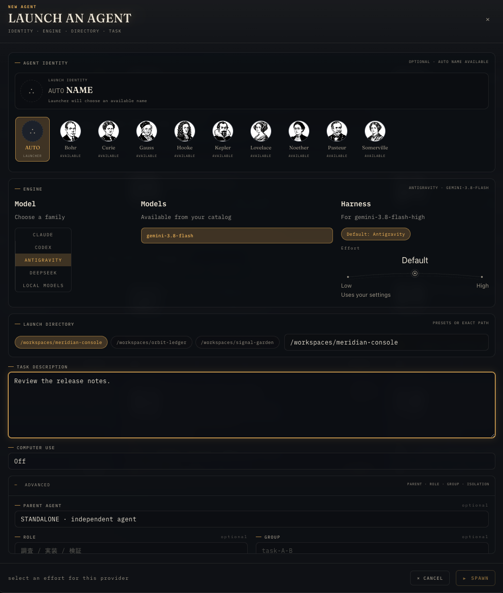
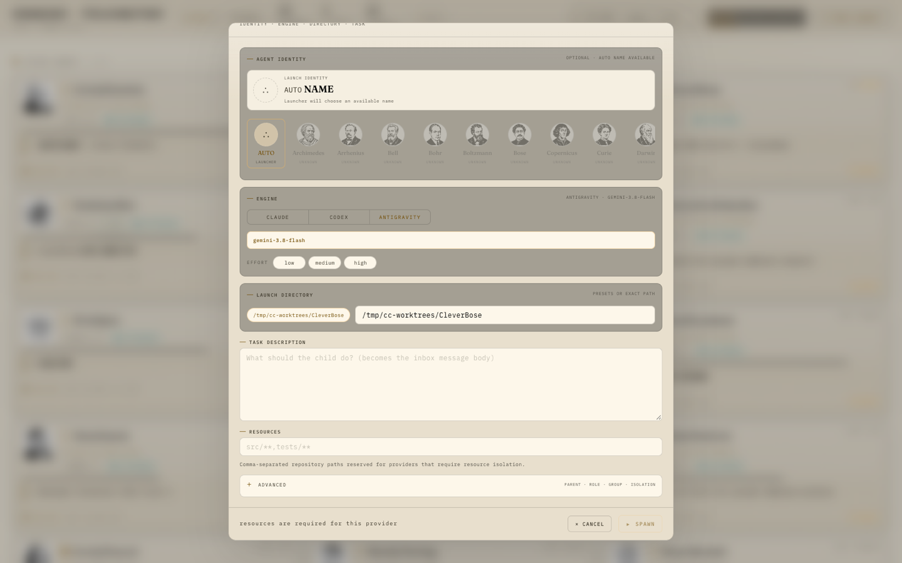

# Google Antigravity / Gemini provider

ORRERY can use Google Antigravity CLI (`agy`) alongside Claude Code and Codex.
The integration uses the user's signed-in Antigravity account.

## Prerequisites

Start with ORRERY core installed and ORRERY Mail running. Follow the
[Google installation guide](https://antigravity.google/docs/getting-started?tab=cli)
and have the user sign in. The official macOS/Linux `install.sh` ends by running
`agy install`, which configures the shell and its PATH. Get the user's approval
for that step. For a binary-only installation, stop before the shell setup.
Check both commands in the current shell:

```sh
agy --version
agy models
```

The standard binary location is `~/.local/bin/agy`.

## Install the optional provider payload

Check the install location and planned copies from an ORRERY Telemetry checkout:

```sh
scripts/install-gemini-provider.sh --dry-run
```

Choose a setup based on how you will use the provider. The dry run works without `agy`.

- For **NEW AGENT** or other delegated children only, run
  `scripts/install-gemini-provider.sh`. The child launcher configures Mail MCP in its worktree.
- **To send Mail from a top-level `agent-start-gemini` session**, first run
  `scripts/install-gemini-provider.sh --dry-run --configure-mcp`. Show the user
  the planned `orrery-mail` entry in `~/.gemini/config/mcp_config.json`. After approval,
  run the following command. This also works if the provider is already installed.

```sh
scripts/install-gemini-provider.sh --configure-mcp
```

Restart the Dashboard after installation:

```sh
~/.agentstack/dashboard/agentctl.sh restart
```

The optional installer copies provider files. If it reports an outdated core,
update the core and run the installer again.

## Show account quota in Usage left

With the user's approval, create the `antigravity-quota.enabled` marker in the
Dashboard's runtime directory. For the standard installation:

```sh
quota_runtime="$HOME/.agentstack/runtime"
test -d "$quota_runtime" && touch "$quota_runtime/antigravity-quota.enabled"
```

If the Dashboard uses a custom `AGENTSTACK_RUNTIME_DIR`, use the service's value.
After opt-in, the Dashboard runs `agy -p /usage --output-format json` to read
quota for the signed-in account. It requires CLI 1.1.24 or later. Look for
**Antigravity (Gemini)** under **Usage left** in the cockpit. The initial read
or an existing `unavailable` result may take about three minutes to refresh.
If it still says `unavailable / no windows`, check the marker location, CLI
version and sign-in, then check whether `agy -p /usage --output-format json`
returns quota windows. A Gemini API key is unnecessary for this display.

## Top-level launcher

```sh
~/.agentstack/bin/agentstack-gemini-setup --check
~/.agentstack/bin/agent-start-gemini /path/to/project
```

`--check` verifies the managed global entry. In the running `agy` session,
open `/mcp` to see whether `orrery-mail` is connected, then use that server's
`send_message` tool. Use `/mcp` to verify a workspace-level entry too. Roster
registration is a separate step. Tell the operator if MCP is missing or an
approval is required. The interactive launcher uses the legacy runtime. If
the global runtime returns `GEMINI_INTERACTIVE_RUNTIME_UNSUPPORTED`, use its
supported delegated route.

### Reader

With API 48 Telemetry and the matching Cockpit, managed interactive `agy` sessions are readable in the desktop and phone Reader. The existing `--configure-mcp` option adds the `orrery-reader` group to `hooks.json` and preserves the user's other groups. After setup, newly launched sessions show history from their first input. Text appears as Antigravity records it, and a finished compact appears as **Context compacted**. If a launch reports different conversation UUIDs, Reader waits for a new managed launch to establish its binding.

Defaults:

- binary: `agy`
- model: `gemini-3.8-flash-high`
- effort: `high` (from `AGENTSTACK_GEMINI_EFFORT`)

The CLI launchers (`agent-start-gemini`, `spawn_gemini_child.sh`, and a direct
`spawn_gemini_preregistered.sh` run) keep this `high` fallback. The Dashboard
does not use it; see [Dashboard NEW AGENT](#dashboard-new-agent).

For binary-free validation:

```sh
AGENTSTACK_GEMINI_BIN=agy-not-installed \
  ~/.agentstack/bin/agent-start-gemini --dry-run /path/to/project
```

Dry-run stops before binary lookup, tmux, ORRERY Mail registration, and MCP
bootstrap. A real launch still fails clearly if `agy` is absent.

## Delegated child

```sh
PARENT_AGENT=<parent-name> \
~/.agentstack/hooks/spawn_gemini_child.sh \
  --resources "src/**,tests/**" \
  "Implement the requested change and run relevant tests." \
  /path/to/project
```

The launcher pre-registers the child, creates an isolated git worktree, reserves
declared resources, sends the task to Antigravity over stream-json stdin, and
uses the session-bound MCP wrapper. Owner-token values are not placed in the
task, argv, or Antigravity MCP configuration.

A nominal Antigravity `SUCCESS` is not enough when required actions were denied
or the textual response is empty. Those cases are reported to the parent as
incomplete. A non-zero launcher/runtime status is likewise incomplete.

## Dashboard NEW AGENT

When the optional provider is installed and Dashboard restarts, **NEW AGENT**
offers Antigravity. On macOS, you can leave the parent blank and open an
interactive agent in the selected folder, including a folder outside Git.
The CLI receives the first task once and supports Mail, Reader, and Resume.
ORRERY loads its Mail and hook settings from a private directory for that
launch and removes the directory when the agent exits. The selected folder and
personal configuration need no changes.





Requirements checked before ORRERY Mail registration, so a launch that cannot
start does not leave a retained child identity behind:

- Linux/WSL launches and delegated macOS launches require a parent and its
  local owner credential.
- Launches with a worktree require a Git repository and a base that resolves
  to a commit (default `HEAD`).
- The launcher requires `agy`, `tmux`, the selected Python, the adapter hook,
  and the Gemini provider helpers.
- `AGENTSTACK_GEMINI_MODELS`, when explicitly set, is the restrictive model
  allow-list. Otherwise, the picker combines the bundled `gemini-3.8-flash-{high,medium,low}`
  candidates with valid Gemini IDs from the installed `agy models` CLI. This
  read may contact the CLI's model service; ORRERY reads no CLI credentials.
  Discovery uses the same binary lookup as spawn preflight, including `~/.local/bin`
  when the Dashboard's service PATH omits it. If only `gemini-3.8-flash` appears,
  check `agy models`, the Dashboard restart and any explicit model allow-list.
  Queries are limited to 5 seconds and 64 KiB of output. Successful results are
  cached for 5 minutes; a failure is retried after 5 seconds without discarding
  the last successful list. Claude and GPT entries are excluded. A known Gemini
  model can also be supplied by formal ID without discovery, but that does not
  prove access to it; the CLI ultimately checks availability at launch. An
  explicit allow-list that reuses a Claude/Codex ID disables the Antigravity tab.

The model card displays each Gemini family once (for example, `gemini-3.8-flash`
and `gemini-4-argon`). The original `gemini-3.8-flash-high` remains the default;
only efforts present in the current model list are offered for each family.
Before registration, Dashboard resolves the selected effort to the corresponding CLI model:
`low` → `gemini-3.8-flash-low`, `medium` → `gemini-3.8-flash-medium`, and
`high` → `gemini-3.8-flash-high`. Registration, launch logs, and `agy --model`
use that same resolved id alongside the explicit `--effort`. A custom model
allow-list must include the matching variant; otherwise the request is rejected
before registration. Without a custom allow-list, a formal `gemini-*` ID is
validated by the CLI instead of being refused simply because discovery omitted it.
Model IDs without an effort suffix are passed unchanged. Spawn and `dry_run`
do not run `agy models`; discovery is used only for the picker.

Engine and isolation rules:

- **Effort is explicit.** The Dashboard selects no effort for Antigravity, keeps
  `SPAWN` disabled until an available effort is chosen (`low`, `medium`, `high`,
  or `xhigh` where the catalog lists that variant), and the server
  rejects a request without one (`effort required for provider gemini`). The
  CLI launchers' `high` fallback is not applied to Dashboard launches.
- **Delegated launches use an isolated worktree.** On macOS, a standalone
  launch creates a worktree when you select Isolation.
- **Delegated launches require resources.** Enter comma-separated paths relative to the
  repository root, for example `src/**,tests/**`. Absolute paths, `..`, `~`,
  control characters, a leading `-`, backslashes, and `.git` are rejected, as
  is any existing symlink component that resolves outside the repository. The
  adapter repeats the check inside the new worktree before reserving anything.
  Declarations are normalized (whitespace, `./`, duplicate slashes, repeats)
  before they are reserved, and a leading `-` is rejected in the normalized
  form too (`./-rf`). Wildcards are matched the way a case-insensitive
  filesystem such as default APFS resolves names, so `.GI?/config` or `SR?/**`
  is judged against `.git` or `src` in any letter case.

The launcher delivers the first task to Antigravity. Delegated launches on
Linux/WSL report to the parent when they exit. Interactive agents on macOS
can receive follow-up requests through Mail. `/api/spawn-status` and
`dashboard/logs/spawn.log` record `provider=gemini`.

The core Dashboard modal interprets the provider `capabilities` contract. The
optional payload only adds the Antigravity catalog item and its `/api/spawn`
branch; it does not rewrite the page while serving it. If the core page lacks
the capability marker or resources control, the Antigravity tab is omitted and
Antigravity spawn requests fail closed; the reason is written to the Dashboard
log. Claude and Codex are unaffected, including when the extension itself
cannot be loaded.

## Dashboard controls

The Dashboard uses the same provider-aware process-tree measurement for Claude,
Codex, and Antigravity. For a delegated Antigravity child, `EXIT` re-reads the
process tree immediately, sends `SIGINT` only to the measured `agy` process, and
leaves the launcher-owned shell runner alive so report/release/retire/cleanup can
finish. For a top-level interactive Antigravity session, `EXIT` keeps the normal
interactive `/exit` path.

ORRERY does not currently implement Antigravity conversation resume or native
transcript history. Gone or retired Antigravity entries therefore fail closed
instead of falling through to Claude/Codex transcript lookup. A top-level
Antigravity session whose `agy` process has exited but whose human shell remains
is kept attachable as `finished`; Dashboard jump does not kill that shell to
attempt an unsupported resume.

## Headless permission caveat

Gemini launchers use the CLI's execution mode and `toolPermission` as shown in
`/config`. With CLI 1.5.7 or later and no `agentMode` set, Auto is the default
where available, with `default` mode elsewhere. `accept-edits` approves
workspace edits, and `plan` is for investigation and planning. Auto depends
on account and terminal sandbox support. MCP calls may still require approval.
[Google's CLI permissions guide](https://antigravity.google/docs/permissions?tab=cli)

Delegated Gemini runs headless, so a permission request that needs an interactive
response fails. Its permissions are separate from the
[Claude/Codex child launch policy](delegation.en.md). For example, the Codex
child's `--ask-for-approval never` default does not apply to Gemini. ORRERY leaves
`--mode`, `--sandbox` and `--dangerously-skip-permissions` unset for Gemini.

In a measured macOS run using Antigravity CLI 1.1.27, headless `view_file`
inside the delegated worktree was auto-denied until `read_file` was explicitly
allowed by the user. The stderr message stated that headless mode could not
prompt for the required permission.

Use the narrowest rule that covers the **resolved** delegated-worktree root.
New installs default to `~/.agentstack/worktrees`; replace the example user
home with the actual resolved path. Keep the legacy `/private/tmp` rule only
while a pre-#57 worktree remains there:

```json
{
  "permissions": {
    "allow": [
      "read_file(/path/to/home/.agentstack/worktrees)",
      "read_file(/private/tmp/cc-worktrees)"
    ]
  }
}
```

Merge such a rule with the user's existing settings; do not replace existing
permission entries. If `AGENTSTACK_WORKTREE_ROOT` is customized, scope the rule
to that resolved root instead. Remove the legacy rule after its old worktrees
are gone; ORRERY does not migrate or delete them.

ORRERY does not add `read_file(*)`, does not enable
`--dangerously-skip-permissions`, and does not otherwise broaden user-owned
Antigravity permissions.

For a managed interactive launch on macOS, `--settings` grants individual
`orrery-screen` tools for that session according to the selected screen mode.
View grants the read-only tools. Control grants the read-only and interaction
tools. Existing Ask and Deny rules still take precedence. Global settings are
unchanged.

## Credential boundary

The session-bound wrapper resolves the current agent's mode-0600 runtime token
file when the MCP process starts. Antigravity workspace/global MCP config stores
only the wrapper command, not the owner-token value or token-file path.

`agy` and ORRERY still run as the same operating-system user. This reduces
accidental configuration/argv exposure; it is not an OS-level isolation
boundary against another process running as that user.

## Design boundary

The provider adds `program=antigravity` / `agy` to the core's shared
process-tree liveness. The provider extension ships with the optional installer.
The core installer leaves an already-installed extension in place.

- Top-level `agy` exits to its interactive shell, which remains attachable as `finished`.
- A delegated launcher reports the result, releases reservations, soft-retires the identity,
  and removes transient config and credentials before its own exit.

The Dashboard reports measured process and tmux state.

## Measured macOS E2E

The pre-upstream prototype was exercised on macOS with Antigravity CLI 1.1.27
and Gemini 3.8 Flash High.

Normal delegated completion was measured through preregistration, worktree
creation, reservation, headless execution, non-empty `SUCCESS`, parent
`Gemini child complete` reporting, release/retire/cleanup, and child tmux
session disappearance.

A live Dashboard `EXIT` run produced Antigravity `ERROR / interrupted`; the
launcher-owned runner remained alive long enough to report
`Gemini child incomplete`, release the reservation, retire/clean transient
state, and then let the child tmux session disappear. The parent and
`mail-watcher` survived, and the same resource was immediately reservable by a
subsequent child.

Those real-machine observations are evidence for the provider lifecycle. Final
upstream-ready validation must be repeated after integrating onto the current
upstream base.
