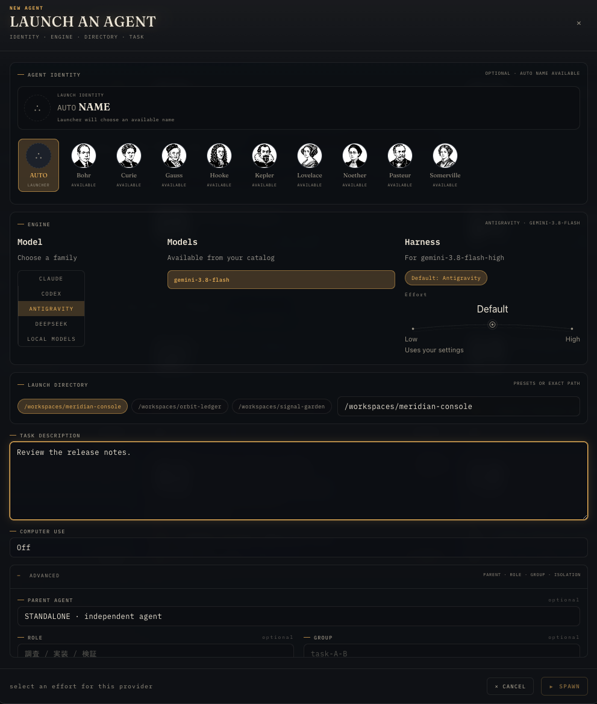
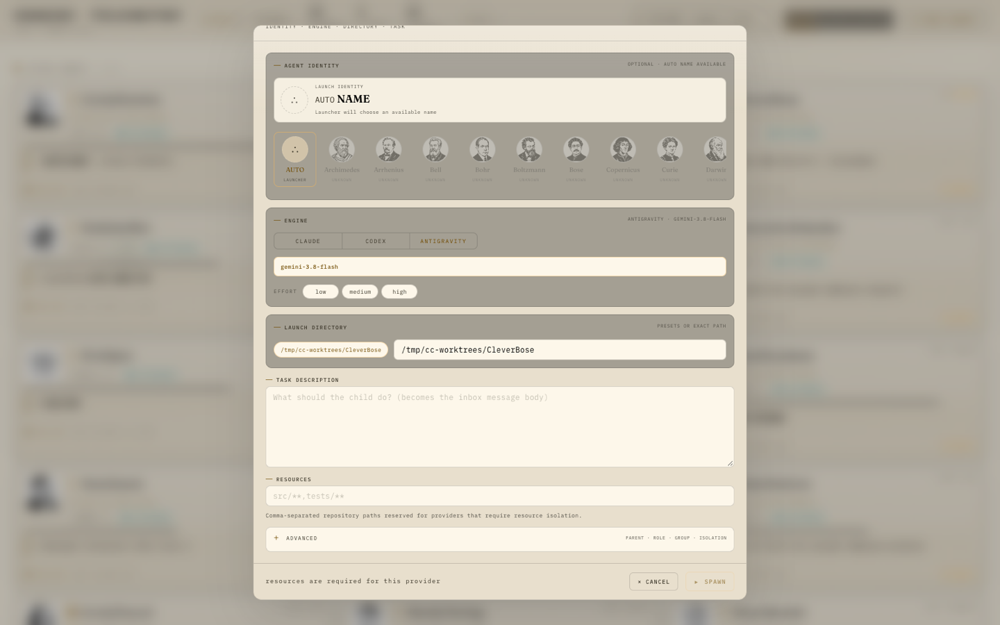

# Google Antigravity / Gemini provider

ORRERY では、Claude Code や Codex と並んで Google Antigravity CLI（`agy`）を
使えます。利用者が Antigravity でサインインしたアカウントを使います。

## Prerequisites

先に ORRERY core と稼働中の ORRERY Mail を用意します。
[Google の手順](https://antigravity.google/docs/getting-started?tab=cli)で CLI を導入し、
利用者がサインインします。macOS / Linux 向けの公式 `install.sh` は最後に
`agy install` を呼び、シェルの PATH 設定などを変更します。利用者の了承を得て実行し、
設定ファイルをそのままにしたい場合はバイナリだけを導入する段階で止めます。
現在のシェルから次の両方が通ることを確認します。

```sh
agy --version
agy models
```

標準のバイナリ配置は `~/.local/bin/agy` です。

## Install the optional provider payload

ORRERY Telemetry の checkout で、まず導入先とコピー予定を確認します。

```sh
scripts/install-gemini-provider.sh --dry-run
```

導入方法は使う経路で選びます。`--dry-run` は `agy` のない環境でも使えます。

- Dashboard の **NEW AGENT** または委任する子だけで使う場合は
  `scripts/install-gemini-provider.sh` を実行します。子の Mail MCP は作業用 worktree に用意されます。
- **`agent-start-gemini` で立てる親なし agent から Mail を送る場合**は、
  `scripts/install-gemini-provider.sh --dry-run --configure-mcp` で追加先を確認します。
  `~/.gemini/config/mcp_config.json` に `orrery-mail` を設定する変更を利用者に示し、
  了承後に次を実行します。すでに provider を導入済みの場合も同じコマンドです。

```sh
scripts/install-gemini-provider.sh --configure-mcp
```

導入後、Dashboard を再起動します。

```sh
~/.agentstack/dashboard/agentctl.sh restart
```

optional installer は provider のファイルだけをコピーします。必要な core が古い場合は
core を更新してから再実行します。

## Usage left に利用枠を表示

利用枠を表示する場合は、利用者の了承を得て Dashboard の runtime ディレクトリに
`antigravity-quota.enabled` を作ります。標準の導入先なら次の手順です。
`AGENTSTACK_RUNTIME_DIR` をカスタマイズした場合は、Dashboard サービスが使う設定値を指定します。

```sh
quota_runtime="$HOME/.agentstack/runtime"
test -d "$quota_runtime" && touch "$quota_runtime/antigravity-quota.enabled"
```

有効にすると Dashboard は `agy -p /usage --output-format json` でサインイン済みの
アカウントの利用枠を読みます。CLI 1.1.24 以降が必要です。導入後は Cockpit の
**Usage left** で **Antigravity (Gemini)** を確認します。初回の取得や、すでに表示されている
`unavailable` の更新には、キャッシュ分の最大約3分かかることがあります。
`unavailable / no windows` が続く場合は、marker の場所、CLI のバージョン、サインインを確認し、
`agy -p /usage --output-format json` が利用枠を返すか確認します。利用枠の表示には Gemini API キーは不要です。

## Top-level launcher

```sh
~/.agentstack/bin/agentstack-gemini-setup --check
~/.agentstack/bin/agent-start-gemini /path/to/project
```

`--check` は管理されたグローバル MCP 定義を確認します。起動後は `agy` の `/mcp` で
`orrery-mail` が接続済みであることを確認し、Mail にはその `send_message` を使います。
プロジェクト専用の MCP 定義を使う場合も、接続の確認場所は `/mcp` です。
名簿への登録は別の処理です。MCP が見つからない、または承認が必要なら利用者に伝えます。
この対話起動は legacy runtime 用です。global runtime の
`GEMINI_INTERACTIVE_RUNTIME_UNSUPPORTED` が出る場合は、対応する委任経路を使います。

### Reader

API 48 対応の Telemetry と Cockpit で、管理された対話型 `agy` の会話を Desktop とスマホの Reader から読めます。既存の `--configure-mcp` が `hooks.json` に `orrery-reader` グループを追加します。管理グループ以外の設定は保持します。設定後に起動したセッションで、最初の入力から履歴が表示されます。本文は Antigravity が記録した時点で表示し、compact の完了は **Context compacted** として表示します。同じ起動で異なる会話 UUID を検出したときは、次の管理された起動まで binding を保留します。

Defaults:

- binary: `agy`
- model: `gemini-3.8-flash-high`
- effort: `high` (from `AGENTSTACK_GEMINI_EFFORT`)

The CLI launchers (`agent-start-gemini`, `spawn_gemini_child.sh`, and a direct
`spawn_gemini_preregistered.sh` run) keep this `high` fallback. The Dashboard
does not use it; see [Dashboard NEW AGENT](#dashboard-new-agent).

For binary-free validation:

```sh
AGENTSTACK_GEMINI_BIN=agy-not-installed \
  ~/.agentstack/bin/agent-start-gemini --dry-run /path/to/project
```

Dry-run stops before binary lookup, tmux, ORRERY Mail registration, and MCP
bootstrap. A real launch still fails clearly if `agy` is absent.

## Delegated child

```sh
PARENT_AGENT=<parent-name> \
~/.agentstack/hooks/spawn_gemini_child.sh \
  --resources "src/**,tests/**" \
  "Implement the requested change and run relevant tests." \
  /path/to/project
```

launcher は子を事前登録し、専用の worktree を作り、宣言したファイルを予約します。
Mail はその子に紐付いた MCP wrapper を通ります。owner token は private な runtime に保持します。

macOS では `agy` の対話画面を開き、最初の仕事を `-i` で渡します。
子は Mail の `send_message` で報告したあとも待機し、追加 Mail は共通 watcher が入力欄へ届けます。
サンドボックスを有効にし、その子の worktree だけを起動時の `trustedWorkspaces` に渡します。
ネイティブ編集は共通の登録・予約確認を通ります。macOS の対話子には Antigravity Reader の payload が必要です。

Linux／WSL の既存経路は最初の task を stream-json の標準入力に流し、自動報告して終了します。

A nominal Antigravity `SUCCESS` is not enough when required actions were denied
or the textual response is empty. Those cases are reported to the parent as
incomplete. A non-zero launcher/runtime status is likewise incomplete.

## Dashboard NEW AGENT

provider を導入して Dashboard を再起動すると、**NEW AGENT** に Antigravity が出ます。
macOS では親を選ばずに、指定したフォルダで対話型 agent を起動できます。Git を使っていない
フォルダも選べます。最初の文は CLI に一度だけ渡り、Mail、Reader、履歴からの Resume を使えます。
ORRERY の Mail と hook の設定は起動ごとの専用ディレクトリに置き、終了時に削除します。
選んだフォルダと個人設定には起動用の設定を書き込みません。





Requirements checked before ORRERY Mail registration, so a launch that cannot
start does not leave a retained child identity behind:

- Linux／WSL の起動と macOS の委任起動には、親の agent とその所有資格が必要です。
- worktree を使う場合は、Git リポジトリ内のフォルダと有効な base（既定は `HEAD`）が必要です。
- `agy`、`tmux`、選択された Python、adapter hook、Gemini provider の helper が必要です。
- `AGENTSTACK_GEMINI_MODELS` を明示した場合、モデルはその許可リストに限定されます。
  未設定なら、同梱の `gemini-3.8-flash-{high,medium,low}` と `agy models` が返した有効な
  Gemini ID を表示します。モデルの取得は起動前の検査と同じ方法で `agy` を探すため、
  Dashboard の PATH に `~/.local/bin` がなくても標準の場所を使えます。
  `gemini-3.8-flash` しか表示されない場合は、`agy models` の結果、Dashboard を再起動したか、
  許可リストの設定を確認します。
  取得を待つ時間は5秒、出力は64 KiBまでです。成功は5分間キャッシュされ、失敗時は前回の
  成功結果を保ち、5秒後以降に再試行します。Claude と GPT の ID は除外します。
  許可リストに Claude／Codex と同じ ID を指定すると Antigravity のタブは無効になります。
  リストにない正式な Gemini ID も起動時に指定でき、利用可否は CLI が確認します。

The model card displays each Gemini family once (for example, `gemini-3.8-flash`
and `gemini-4-argon`). The original `gemini-3.8-flash-high` remains the default;
only efforts present in the current model list are offered for each family.
Before registration, Dashboard resolves the selected effort to the corresponding CLI model:
`low` → `gemini-3.8-flash-low`, `medium` → `gemini-3.8-flash-medium`, and
`high` → `gemini-3.8-flash-high`. Registration, launch logs, and `agy --model`
use that same resolved id alongside the explicit `--effort`. A custom model
allow-list must include the matching variant; otherwise the request is rejected
before registration. Without a custom allow-list, a formal `gemini-*` ID is
validated by the CLI instead of being refused simply because discovery omitted it.
Model IDs without an effort suffix are passed unchanged. Spawn and `dry_run`
do not run `agy models`; discovery is used only for the picker.

Engine and isolation rules:

- **Effort is explicit.** The Dashboard selects no effort for Antigravity, keeps
  `SPAWN` disabled until an available effort is chosen (`low`, `medium`, `high`,
  or `xhigh` where the catalog lists that variant), and the server
  rejects a request without one (`effort required for provider gemini`). The
  CLI launchers' `high` fallback is not applied to Dashboard launches.
- **親付きの起動は worktree を使います。** macOS の親なし起動で worktree を作るには、
  Isolation を選びます。
- **親付きの起動は予約対象が必要です。** Enter comma-separated paths relative to the
  repository root, for example `src/**,tests/**`. Absolute paths, `..`, `~`,
  control characters, a leading `-`, backslashes, and `.git` are rejected, as
  is any existing symlink component that resolves outside the repository. The
  adapter repeats the check inside the new worktree before reserving anything.
  Declarations are normalized (whitespace, `./`, duplicate slashes, repeats)
  before they are reserved, and a leading `-` is rejected in the normalized
  form too (`./-rf`). Wildcards are matched the way a case-insensitive
  filesystem such as default APFS resolves names, so `.GI?/config` or `SR?/**`
  is judged against `.git` or `src` in any letter case.

最初の task は launcher が Antigravity に渡します。Linux／WSL の委任は終了時に自動で
親へ報告します。macOS の対話型 agent は、起動後に Mail から追加の依頼を受け取れます。
`/api/spawn-status` と `dashboard/logs/spawn.log` は `provider=gemini` を記録します。

The core Dashboard modal interprets the provider `capabilities` contract. The
optional payload only adds the Antigravity catalog item and its `/api/spawn`
branch; it does not rewrite the page while serving it. If the core page lacks
the capability marker or resources control, the Antigravity tab is omitted and
Antigravity spawn requests fail closed; the reason is written to the Dashboard
log. Claude and Codex are unaffected, including when the extension itself
cannot be loaded.

## Dashboard controls

macOS の対話子は `EXIT` で終了し、予約を解放して保持期間に入ります。
`Resume` は確認できた同じ登録・worktree・会話 ID を使います。
再開後に編集するときは必要な予約を取り直します。履歴を照合できない場合は理由を返します。

stream-json の子には、直前に確認した `agy` に `SIGINT` を送り、runner が報告・予約解放・退役を行います。
親なしの対話 Antigravity は通常の `/exit` を使い、人のシェルが残った場合は `finished` から端末を開けます。

## Headless permission caveat

`agent-start-gemini` と stream-json の子は `--mode` を指定しません。
CLI の `/config` にある実行モードと `toolPermission` が適用されます。1.5.7 以降、
`agentMode` が未設定なら、利用可能な環境で Auto、それ以外は `default` になります。
`accept-edits` は作業領域の編集を自動承認し、`plan` は調査と計画に使います。
Auto が利用できるかはアカウントと端末の sandbox に依存し、MCP の呼び出しには別途確認が出ることがあります。
[Google の CLI 権限ガイド](https://antigravity.google/docs/permissions?tab=cli)

Gemini child は headless で動き、対話で答える必要がある承認は失敗として返ります。
[Claude／Codex の子の起動設定](delegation.md)とは別に扱われます。たとえば親付き Codex の
`--ask-for-approval never` は Gemini に引き継がれません。ORRERY は Gemini に
`--sandbox` や `--dangerously-skip-permissions` を追加せず、CLI の設定に従います。

In a measured macOS run using Antigravity CLI 1.1.27, headless `view_file`
inside the delegated worktree was auto-denied until `read_file` was explicitly
allowed by the user. The stderr message stated that headless mode could not
prompt for the required permission.

Use the narrowest rule that covers the **resolved** delegated-worktree root.
New installs default to `~/.agentstack/worktrees`; replace the example user
home with the actual resolved path. Keep the legacy `/private/tmp` rule only
while a pre-#57 worktree remains there:

```json
{
  "permissions": {
    "allow": [
      "read_file(/path/to/home/.agentstack/worktrees)",
      "read_file(/private/tmp/cc-worktrees)"
    ]
  }
}
```

Merge such a rule with the user's existing settings; do not replace existing
permission entries. If `AGENTSTACK_WORKTREE_ROOT` is customized, scope the rule
to that resolved root instead. Remove the legacy rule after its old worktrees
are gone; ORRERY does not migrate or delete them.

ORRERY does not add `read_file(*)`, does not enable
`--dangerously-skip-permissions`, and does not otherwise broaden user-owned
Antigravity permissions.

macOS の管理された対話セッションでは、起動時に選んだ画面の段に応じて
`--settings` で `orrery-screen` の個々の道具をそのセッションだけ許可します。
View は読み取り系、Control は読み取りと操作系を許可します。
利用者の既存の Ask と Deny が優先され、グローバル設定は書き換えません。
親なしの Resume は初回の選択と前世代の relay の状態を照合し、低い方から新しい relay と
CLI の自動許可を作ります。親ありの Resume は作業ツリーの MCP 設定をそのまま使います。
無効化、ツールの制限、relay の接続先を引き継ぎ、画面ツールは既存の CLI の承認ルールに従います。
親なしで選んだ作業フォルダに競合する画面・ブラウザ用 MCP が有効な場合は、
競合の理由を返して起動を止めます。

## Credential boundary

The session-bound wrapper resolves the current agent's mode-0600 runtime token
file when the MCP process starts. Antigravity workspace/global MCP config stores
only the wrapper command, not the owner-token value or token-file path.

`agy` and ORRERY still run as the same operating-system user. This reduces
accidental configuration/argv exposure; it is not an OS-level isolation
boundary against another process running as that user.

## Design boundary

The provider adds `program=antigravity` / `agy` to the core's shared
process-tree liveness. The provider extension ships with the optional installer.
The core installer leaves an already-installed extension in place.

- Top-level `agy` exits to its interactive shell, which remains attachable as `finished`.
- A delegated launcher reports the result, releases reservations, soft-retires the identity,
  and removes transient config and credentials before its own exit.

The Dashboard reports measured process and tmux state.

## Measured macOS E2E

The pre-upstream prototype was exercised on macOS with Antigravity CLI 1.1.27
and Gemini 3.8 Flash High.

Normal delegated completion was measured through preregistration, worktree
creation, reservation, headless execution, non-empty `SUCCESS`, parent
`Gemini child complete` reporting, release/retire/cleanup, and child tmux
session disappearance.

A live Dashboard `EXIT` run produced Antigravity `ERROR / interrupted`; the
launcher-owned runner remained alive long enough to report
`Gemini child incomplete`, release the reservation, retire/clean transient
state, and then let the child tmux session disappear. The parent and
`mail-watcher` survived, and the same resource was immediately reservable by a
subsequent child.

Those real-machine observations are evidence for the provider lifecycle. Final
upstream-ready validation must be repeated after integrating onto the current
upstream base.
