# Dashboard

> English version: [dashboard.en.md](dashboard.en.md)

[前: Codex App 統合](codex-app.md) · [README に戻る](../README.md) · [次: API reference](api.md)

dashboard は既定で `http://127.0.0.1:8770/` に公開されます。tmux、ORRERY Mail SQLite、runtime state、project log、任意の Obsidian link hint を読み合わせ、観測と安全な control operation を一つの画面にまとめます。

見え方と動きの決まりは [デザイン言語](design.md) にあります。UI を足す・直す前にそちらを読んでください。

起動時には `pkill` で前回の browser terminal（ttyd）の残存プロセスを整理します。
`pkill` がない環境では、この整理だけをスキップして HTTP server を起動します。
この処理は Windows native の installer や Codex App Bridge を対応済みにするものではありません。

ここでいう ORRERY Mail / mail-watcher は、ORRERY Telemetry 内のエージェント間メッセージを扱う機構です。利用者のメールアカウント、メールクライアント、受信箱には一切アクセスしません。

## やりたいことから探す

| やりたいこと | 最短の操作 |
| --- | --- |
| 今動いているエージェントを見る | [DECK](#deck) を開き、`ACTIVE AGENTS` のカードを見る。カードをクリックすると task、live state、History、Output、terminal 操作をまとめて確認できます。 |
| 親子関係を見る | [NETWORK](#network) に切り替える。parent と child は spawn edge で結ばれ、node をクリックすると個別の詳細 panel が開きます。 |
| エージェント同士が何を話したか読む | NETWORK の communication edge をクリックする。右側の mail drawer に、その2者間の subject、importance、時刻、本文が表示されます。[mail 設定がない場合](#edge-と-mail)は `NOT CONFIGURED` になります。 |
| 複数のエージェントをまとめて操作する | NETWORK 上部の `Select` を有効にし、node をクリックするか空白部分を矩形 drag する。選択後に画面下部へ出る action bar で、running / finished agent は `Exit N`、2人以上は `Replay N` を選べます。EXIT は同じ button をもう一度押す二段確認です。 |
| 終了したエージェントを resume する | tmux 型の Claude / Codex CLI agent では、DECK の history を `30d` か `all` にするか、NETWORK の `ALL` で過去 agent を出します。card の `RESUME READY`、または古い Claude row の `RESUME · VERIFY` から復元できます。後者は詳細 panel の `VERIFY & RESUME` を1回押すと検証から resume まで続けます。NETWORK の `Select` は、事前検証済みの `resume_capability: ready` の gone / retired node だけを `Resume N` に数えます。resume には検証済み transcript、元の cwd、対応 CLI、本人 credential が必要です。窓を開く場合は terminal adapter も必要で、Codex child では provenance・正式登録・credential・復元可能な設定も必要です。 |
| 終わったエージェントを見る | NETWORK の time window を `ALL` にするか、DECK の history を `7d` / `30d` / `all` に切り替える。既定の `live` は running と finished だけで、`7d` / `30d` はその期間に活動した `gone` / `retired` card を、`all` は登録された全 agent を表示します。[完了後の見え方](#child-完了後の表示)も参照してください。 |

NETWORK は選択中の time window 外にある node を表示しないことがあります。現在の graph に見えないことだけでは task failure を意味しないため、`ALL`、DECK の history `all`、親へ届く完了報告を確認してください。

## DECK

### Provider 停止の自動通知（legacy）

稼働中の Codex CLI が `Selected model is at capacity. Please try a different model.` で入力待ちになったら、DECK に `MODEL CAPACITY`、NETWORK に `CAPACITY` を表示します。dashboard server はブラウザが閉じていても約5秒ごとに確認し、別の pane capture で2回確認した停止を親の `PARENT_AGENT` へ ORRERY Mail で通知します。差出人は停止した子の既存 identity、本文冒頭は「telemetry の自動検知」で、JST の検知時刻とエラー行を載せます。自動再開・モデル変更・pane へのキー送信はしません。

同じ停止の通知は1回だけです。`AGENTSTACK_RUNTIME_DIR/provider-stalls.json` に状態を保存し、dashboard 再起動後も重複を防ぎます。作業再開を観測した後の次の停止は再び通知します。作業を観測できなくても、同じ pane の前の停止に続いて「提出済みの新しい入力→新しい容量エラー」が追記されたと特定できれば、新しい停止の候補にします。同じ入力とエラーの境界を別の capture でもう1回確認してから1回通知します。入力途中の composer・Mail の配送記録だけ・同じエラーの再描画・footer や幅の変更だけでは再通知しません。

再試行の特定には、直前の停止と一意に重なる履歴が必要です。capture 間に履歴が押し出された場合、同じ並びが繰り返されて境界が曖昧な場合、引用や複雑な入力ブロックを識別できない場合は、推測せず今の停止を維持します。旧状態ファイルに履歴の境界が無い場合も、最初の観測は基準を保存するだけです。これらでは再試行を見逃すことがあります。2回確認する前に続けて再試行された場合は、最新の境界を確認した時点で1回にまとめます。履歴本文は保存せず、正規化した最大64ブロックの hash と順序を保存します。

親無しは印だけ、親や子の credential を検証できない場合も印を残します。Mail の timeout など受理有無が不明な場合は、重複を避けるため再送せず `delivery_unknown` / `MAIL UNCONFIRMED` を表示します。障害時に「重複なし」と「必ず届く」を両方保証するものではありません。

初版は上記 Codex capacity 文言と、remote compact がその前に `Error running remote compact task: ` を付けた形式だけが対象です。未知の前置きや compact 中の他のエラーへは広げません。過去ログに残ったエラー、作業中・承認待ち、未知の provider エラーは判定しません。tmux を使わない Codex App / headless と **global mode は未対応・後続**です。

Codex 自身が固定エラー文を折り返す場合も検知します。固定文言の単語間だけで改行を1つ許し、空行や無関係な行は連結しません。

エラーと入力欄の間に Codex の background terminal 件数と `/ps`・`/stop` の案内行がある場合も検知します。許すのは実際の単数・複数の固定表示1行だけで、通常の出力・queued input の本文・`/ps` の実行結果は読み飛ばしません。

状態ファイルは capacity 候補を初めて観測したときから作り、変化がある場合だけ保存します。一度も候補になっていない子の work 観測では書き込みません。一度候補になった子は、作業中も約5秒ごとに小さな状態ファイルを書きます。解除後も最新の work capture の順序を永続化し、別 process や再起動後に遅れた capacity が届いて再通知するのを防ぐためです。capture の順序を更新しない巡回では、観測時刻だけの更新は最大1時間に1回です。

状態遷移や work 観測に使った capture の順序を保持し、それ以前の遅れた capture は停止確認・解除に使いません。終了した世代の行は、新しい世代への置換なら7日、不在を tmux で確認できる場合は30日の未観測で削除します。tmux が観測不能なら保持します。Mail の入力検証・contact policy・送信者認証について、受理前だと特定できる固定の拒否文を認識した場合と、JSON-RPC の実行前の要求エラーだけを `failed` にします。DB 保存後の処理でも tool error が返るため、内部エラーや未知の拒否文は `delivery_unknown` に残します。どちらも自動再送しません。

最初は DECK を開きます。**1エージェントが1枚のカード**として並ぶため、誰が何をしているか、入力待ちで止まっていないかを個別に読めます。

次の画像では、上部のカウンタが3体、カードも3枚です。カウンタは全体の数、カードは各エージェントの状態を示します。

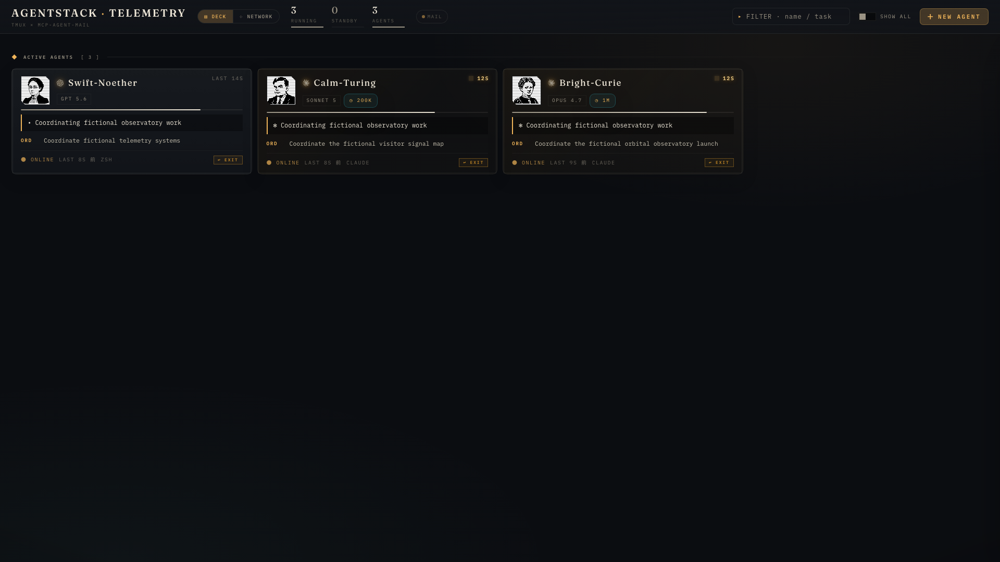

本ページの6枚の画面写真は隔離したデモ環境の実画面です。エージェント名、task、mail、transcript はすべて架空で、実在の作業内容ではありません。

### カードを上から読む

| 表示 | 読み方 |
| --- | --- |
| 名前の下の `GPT 5.6`、`SONNET 5` など | 使用中のモデル。`◷ 200K`、`◷ 1M` がある場合は、そのモデルが使える作業メモリ全体の大きさです。 |
| モデルの下の細い横線 | **残りの作業メモリ（context remaining）**。長いほど余裕があり、残り20%未満では赤寄りになります。telemetry を取得できないカードには出ません。 |
| 黒い帯 | terminal で観測した現在の表示。作業中か待機中かを読む手掛かりです。 |
| `ORD` | そのエージェントに与えられている直近の指示です。 |
| `RX` | ORRERY Mail で直近に受信した指示です。送信者、件名、重要度が並びます。まだ受信がなければ行自体がありません。 |
| `● ONLINE` | agent process が稼働中です。**いま仕事を進めているという意味とは限りません**。 |
| 右上の状態表示 | 黄色の秒数は作業中、薄い `LAST …` は入力待ち、`?` と `APPROVAL` は人の介入待ちです。 |
| `↩ EXIT` | 稼働中のエージェントへ graceful な `/exit` を送ります。誤操作防止のため二度押しで確定します。 |

次の画像では12枚に増え、Warm-Lovelace などのカードに `RX` が現れています。`ORD` と見比べると「担当」と「最後に誰から何を受け取ったか」を分けて読めます。

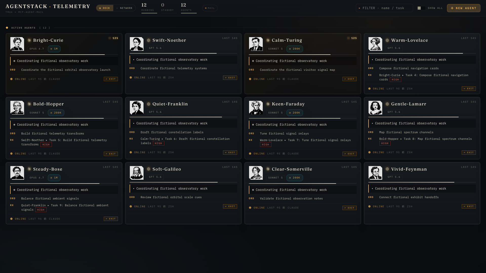

### ヘッダのカウンタとカードの状態を分ける

ヘッダの数字は、各カードが右上と枠で示している状態の**集計**です。

| 表示 | 数えているもの | カードでの見え方 |
| --- | --- | --- |
| `NEED YOU` | 人を待っている agent。承認待ち（`APPROVAL`）と、選択肢を聞いている（`?`） | 赤枠、または `?` |
| `WORKING` | turn が進行中の agent | amber の LED と経過時間 |
| `WAITING` | prompt で入力を待っていて、仕事を渡せる agent | `LAST 1M41S` |

`NEED YOU` は該当する agent がいるときだけ現れ、クリックすると DECK がその agent だけに絞られます（もう一度クリックで戻ります）。process が止まって shell に戻った agent はどの数にも入りません。カードの `○ SHELL` で分かります。active agent の総数は sector 見出しの `ACTIVE AGENTS [ 29 ]` にあります。

**次にどこへ仕事を振るかはヘッダ（WAITING と LEFT）、誰がいま何をしているかは各カード**で確認します。

### 残量（LEFT）

ヘッダの `LEFT` は、各カードの context 残量とは別の、**provider のアカウント全体の利用枠の残り**です。複数の provider を並行して使うときに「次にどこへ振るか」を決めるための数字で、provider の logo と残り % が並びます。クリックすると、provider が返した window（5h、7d、model 別の枠など）ごとの dial と次の reset 時刻が開きます。各 window には取得元と観測時刻が付きます。account の取得に失敗しても前回確認した window の一覧は保持するため、全 window が残っている場合は `DEGRADED`、account の前回値がなく実際に枠が欠ける場合だけ `PARTIAL` と表示します。

- 数字は provider が返した通常枠のうち残りが最も少ない window で、色は残りが 50% 以下で amber、20% 以下で alert になります
- 表示する provider は SETTINGS（NETWORK タブ）の USAGE で選べます。隠した provider は pill と展開表示の両方から消えます。設定はこの browser にだけ残ります
- provider が返していない枠は表示しません。5h の枠が無いアカウントには 5h を出しません
- 取得できていない provider は `WAITING FOR UPDATE` と理由を文字で出します。古い数値は `previous value`（前回値）として取得元・観測時刻を併記し、現在の上限とは扱いません
- 前回値は最終成功から30分、またはその window の reset 時刻のうち早い方まで保持します。期限後も window 名と最終観測時刻は残しますが、現在値を `unknown` とし、数値と残量 ring は出しません。reset 到来だけで100%には戻しません

取得の仕組みは provider ごとに違います（取得層は [kame447](https://github.com/kame447) さんの貢献です。[#31](https://github.com/gyroid-eth/orrery-telemetry/issues/31)）。

| provider | 取得方法 | 必要な設定 |
| --- | --- | --- |
| Codex | `codex app-server` の `account/rateLimits/read` を読みます | なし。`codex` にログイン済みなら表示されます |
| Claude Code | Claude Code がこのマシンに保存している認証情報で、アカウントの usage を読みます（CLI が読むのと同じもの）。5h・7d に加えて、model 別の週次枠（Fable など）もここから来ます | なし。`claude` にログイン済みなら表示されます。止めたい場合は `AGENTSTACK_CLAUDE_ACCOUNT_QUOTA=off` |
| Claude Code（ローカル観測） | statusLine に渡される rate limit を observer が保存したものを読み、account 取得の間も5h・7dを更新します。新しい Claude Code が `model_scoped` を渡した場合は、その session で観測できた model 枠も上記の30分/reset期限まで保持します（observer の保存ファイル自体が古くなった後も window 名は残ります）が、account 取得のように全 model 枠が常に揃うとは限りません | `~/.claude/settings.json` の `statusLine.command` に `python3 ~/.agentstack/dashboard/claude_quota_observe.py` を設定します。既存の statusLine を上書きはしません。自前の statusLine がある場合は `python3 ~/.agentstack/dashboard/claude_quota_observe.py --exec <既存のコマンド>` と包みます。`--exec` は観測だけを行い、payload をそのまま渡して出力を素通しします |
| Antigravity | read-only の usage を読みます | optional provider の導入と opt-in が必要です（[Antigravity](antigravity.md)） |

API は `GET /api/quotas` です。Claude route はローカルの statusLine を30秒 cache で確認しますが、外向きの account 取得はそれと分離され、成功時も600秒＋正方向 jitter より短い間隔では行いません（Codex は120秒、Antigravity は180秒、provider が指定しない場合は60秒）。Claude の window は取得元・観測時刻・`current` / `previous` / `unknown` を個別に返し、API の `status`（鮮度）と `degraded` / `partial`（取得経路・完全性）は同時に成立し得る別の軸です。cache と backoff は dashboard process 内だけの状態なので、同じマシンで dashboard を複数 process 動かすと、その数だけ問い合わせが増えます。

残量の取得でマシンの外に出るのは、Claude のアカウント usage を読む認証付き GET が1本だけです（body なし。プロジェクト名・エージェント名・作業内容は送りません）。redirect は追いません（追うと token が転送先に渡るため）。token はローカルの Claude 認証情報から読み、log にも snapshot にも書きません。429 の再試行は連続回数に応じて600秒、1200秒、2400秒、3600秒（以後3600秒）の待機に正方向 jitter を加え、`Retry-After` の方が長ければそちらを短縮せず使います。この連続回数は credential が変わっても、この dashboard process の中では維持し、認証済みの応答に成功したときだけ指数 backoff を解除します。待機中もローカル観測を読み、同じ credential で最後に成功した account window を上の期限まで併用します。sign-out または credential の変更時は前の snapshot を流用しません。account の取得を off にしている間は認証情報を誰も読まないため sign-out を検知できないので、各回の観測だけで答え、window を読み取りをまたいで持ち越しません。Codex と Antigravity はローカルのプロセスに聞くだけです。

### 人の介入待ちを見逃さない

次の画像で見る場所は、Bright-Curie カード右上の `?` と、Swift-Noether カードの赤い枠と `APPROVAL` です。

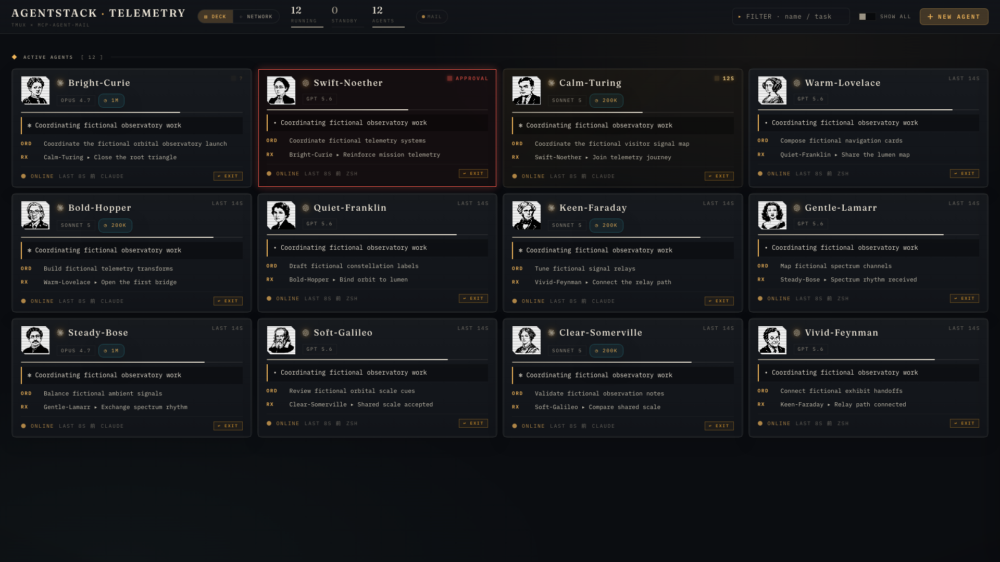

| 合図 | 意味 | 解除方法 |
| --- | --- | --- |
| `?` | エージェントがユーザーへの質問で止まっています。 | terminal で選択肢や回答を入力します。 |
| 赤枠の `APPROVAL` | permission の承認待ちで止まっています。 | terminal で許可または拒否を選びます。 |

どちらも解除するまで先へ進みません。ただし process 自体は生きているため、この画像でもヘッダは `RUNNING 12` のままです。これが、ヘッダの数とカードの状態を分けて読む理由です。

### 該当 terminal を開く

カードをクリックすると、そのエージェントの詳細パネルが開きます。tmux 型の Claude / Codex CLI agent なら、パネル右上の `OPEN TMUX` をクリックすると対応 terminal を前面化または新しく開いて attach します。NETWORK でも、ノードをクリックした後は同じ手順です。

### 分類

- `running`: tmux pane 内で agent process が動作
- `standby`: session はあるが待機状態
- `finished`: agent process は終わったが session / shell は残存
- `gone`: mail record はあるが tmux session がない
- `retired`: soft-retire 済み

mail の `last_active` だけで running と判定せず、tmux process、pane state、session state を合わせます。過去 session を現在実行中と誤表示しないためです。

running と finished の境目は、pane の先頭 process 名ではなく process tree で決めます。Claude も Codex も shell の下で動く（`zsh > claude`、`zsh > node > codex`）ので、`pane_current_command` は生きていても死んでいても shell の名前です。dashboard は 4.5 秒ごとに `ps` を 1 回読み、pane の子孫に登録された program の実体（`claude` / version 名の binary / `node`、`codex`）が居るかで判定します。`ps` が使えない環境では従来どおり pane の command 名と title の glyph に落ちます。

### Lifecycle: EXIT の後に finished と gone のどちらへ行くか

分類は「設計した遷移」ではなく、その時点で測れるもの（tmux session の有無、pane 配下の agent process の有無）を映しています。EXIT は agent に `/exit` を送るだけで、その後 `finished` と `gone` のどちらに落ちるかは Dashboard ではなく、**その agent を起こした launcher が REPL 終了後に shell を残すかどうか**で決まります。

| 起動のしかた | REPL 終了後 | 分類 |
| --- | --- | --- |
| `/delegate` / `spawn_child.sh`（REPL の後ろに cleanup を繋ぐ） | cleanup が reservation 解放と soft-retire を済ませ、command 列が尽きて tmux session も閉じる | `gone`（soft-retire 済みなら `retired`） |
| 対話 shell から手で起動した session、cleanup を後置しない launcher | shell が残る | `finished` |

`finished` は EXIT の次の段階として用意した状態ではなく、shell が残っている現実を表す状態です。provider を追加するときに Claude / Codex と同じ見え方にしたければ、Dashboard 側ではなく child 経路の launcher に cleanup を後置します（[#20](https://github.com/gyroid-eth/orrery-telemetry/issues/20)）。

- `finished` への EXIT は shell に `exit` を送って session を閉じるので `gone` に落ちます
- resume は `finished` / `gone` のどちらも transcript から新しい session を作る同じ経路です。`finished` は先に husk を kill してから乗ります
- `finished` の実用上の違いは、DECK の既定表示に残ること、`OPEN TMUX` で最後の画面と cwd を見に行けることの 2 点です
- husk は待機中の shell 1 個なので、溜めても memory 負荷にはなりません。溜まって困るのは DECK の見通しの方で、retire / kill で片付けます
- 逆に「tmux は生きているのに `retired`」もあります。親が完了報告を受けてすぐ soft-retire した child や、24 時間無活動で ORRERY Mail に retire された常駐 agent がこれで、NETWORK では薄く描かれ、**受信だけが黙って拒否されます**（送信と自分の inbox 読みは通る）。`OPEN TMUX` は retired フラグには触りません。Claude / Codex の resume は CLI 起動前に unretire します。稼働中の agent の受信だけを戻すのは `POST /api/reactivate`（body `{"session": "<name>"}`）で、tmux が生きていることを確かめてから ORRERY Mail の `unretire_agent` を呼びます。自動では戻しません

### 検索

上部の `FILTER · name / task` は、名前だけでなく **task description、live pane title、最後に受け取った指示の subject と送信者**も対象にします。何をしていた agent かを覚えていれば、名前を思い出せなくても引けます。

既定の history `live` では running と finished しか出ません。`7d` / `30d` / `all` に切り替えるとその範囲で活動した `gone` / `retired` も対象に入るので、**終了した agent を検索で見つけて resume する**という使い方ができます。過去の文脈を持った相手を取っておいて、必要になったら再開する形です（手順は[やりたいことから探す](#やりたいことから探す)の「終了したエージェントを resume する」、見え方は[Child 完了後の表示](#child-完了後の表示)）。

card と詳細 panel は backend の `resume_capability` を表示します。終了済み Claude row に exact session index も transcript directory mtime と一致する確定済み cache もない場合、poll 中に大量の transcript を全読みせず `verification_required`（`RESUME · VERIFY`）を返します。詳細 panel の `VERIFY & RESUME` は `/api/jump` の1回の呼び出しで full 検証し、`ready` になればそのまま resume します。確定結果は directory mtime が変わるまで表示にも再利用します。NETWORK の一括 resume は `ready` だけを対象にします。それ以外の非 `ready` 理由では詳細 panel の action は `RESUME UNAVAILABLE` になり、固定理由（`NO HISTORY`、`PROVENANCE MISSING`、`CREDENTIAL MISSING`、`RETENTION EXPIRED`、`PURGED` など）を併記します。新しい Codex child の bound receipt は非秘密の child provenance を cleanup 後も保持し、private state / credential が有効期限内なら `ready` になります。`cx` / `agent-start-codex` など製品が起動した top-level Codex は `launch_origin: standalone` と private owner credential を検証し、child 専用の保持・home 再生成を使わず従来どおり resume します。provenance 導入前や製品外の origin 不明 row は名前や履歴から推測せず `provenance_missing` として閉じます。`/api/jump` も操作直前に同じ判定をやり直すため、古い画面や API の直接呼び出しでこの gate を迂回できません。

### カード操作

- History panel: Claude / Codex transcript
- Output panel: project または設定 root の `LOG_*.md` と成果物
- terminal open / focus
- running agent への二段確認 EXIT。`/api/exit` 自体は finished agent も受け付ける
- tmux client が attach していない finished / gone agent の KILL / soft retire

KILL の可否は frontend の見た目だけで決めず、server の `build_agents()` category を再検証します。attached client がある session では UI が KILL button を隠し、API を直接呼んでも server が `refusing to kill (detach first)` で hard refusal します。

Claude / Codex resume は `AGENTSTACK_AUTO_OPEN_CHILD` に従います。`0` なら窓を開かず detached tmux で会話を再開し、roster に現れます。後から Open tmux や cockpit で開けます。未設定 / `1` は自動表示します。API では `POST /api/jump` の boolean `open` が設定より優先します（`false` は detached、`true` は窓を開く）。Claude は保存済み credential の検証と Mail の受信復帰を済ませてから session を作ります。credential 欠落、期限切れ、purge、認証・unretire の失敗では起動しません。top-level Claude も既存 owner token を使います。

### Child 完了後の表示

正常な completion flow では、`/delegate` で起動した child が終了前に ORRERY Mail の完了報告を親へ送ります。親はその報告を読み、成果物を検証してから利用者へ結果を返します。child の REPL が終了した後は launcher の cleanup が reservation を解放し、remote identity を soft-retire します。Claude / Codex child は生成した MCP config と runtime を削除し、再開用 state / canonical credential を0600で既定30日保持します。Codex は分離 home も削除します。その command の終了に伴い tmux session も閉じます。

保持期間内の `RESUME READY` は、古い home を復元する操作ではありません。dashboard は現在の source Codex home と保存済み profile から新しい home / proxy を作り、credential 付き再登録と fresh binding expectation の保存に成功してから、Codex exec の直前に identity を unretire します。期限切れまたは明示 purge 後は固定理由を表示して fail-closed します。期限切れ private material は dashboard の hourly maintenance が削除するため、dashboard が停止中なら物理削除は次の起動まで遅れることがあります。

このため、完了した child のカードは DECK の通常表示から消えますが、失敗ではありません。history を `30d` にすると直近30日の、`all` にすると全期間の `gone` / `retired` agent もカードとして表示されます。検索が 0 件のときは、どの範囲を見て 0 件だったかと、次に広い範囲へのリンクを空状態に出します。

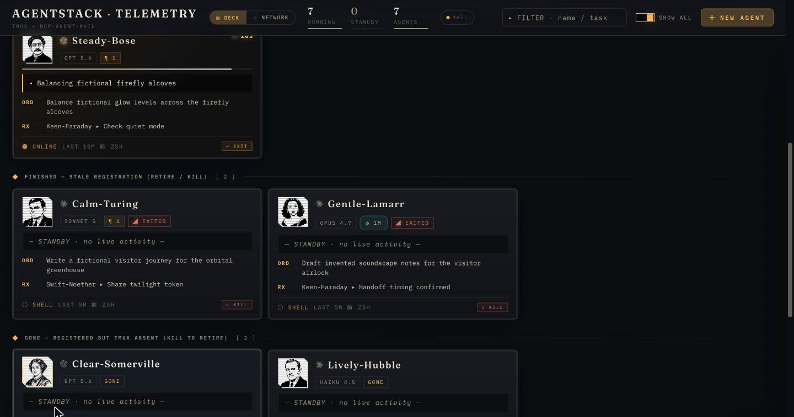

NETWORK は現在の稼働状態と選択した time window を重ねる表示です。完了や retire だけを理由に node を即座に隠すわけではありませんが、last activity が window 外になると child node と、それに接続する spawn / mail edge は表示されません。現在の window に見えないことだけでは task failure を意味しません。履歴を確認する場合は NETWORK の `ALL`、個別の終了状態を確認する場合は DECK の history（`30d` / `all`）を使います。

## Output / deliverables

Output は vault 専用ではありません。`AGENTSTACK_DELIVERABLE_ROOTS` があれば `:` 区切りの root 群、なければ project の `logs/` を再帰走査し、frontmatter の `agent:` が選択 agent と一致する `LOG_*.md` を mtime 降順で最大25件表示します。

project base は絶対 path の `AGENTSTACK_PROJECT_KEY`、絶対 path の `AGENTSTACK_VAULT`、dashboard の cwd / git root の順に fallback します。明示した deliverable root は既定 root を置き換えます。

検出 item が `AGENTSTACK_VAULT` 内なら `obsidian://` link にし、それ以外の generic project / shared log は非リンク項目として表示します。Obsidian がなくても一覧と成果物数は利用できます。

## Codex App runtime

[Codex App 統合](codex-app.md)を導入すると、dashboard は Bridge の allowlist 済み snapshot を tmux state と並べて読みます。同じ ORRERY Mail 名の row を `surface: codex-app` として昇格し、`Codex App · <state>` または `Codex App · wake:<status>` を live 表示します。

- `registering / working / waiting / blocked`: running 扱い
- `dormant / degraded`: finished 扱い
- active 系 state でも snapshot 更新が10分以上ない: stale な running 表示を避けるため dormant 扱い
- capability: `open` のみ

Codex App runtime には tmux pane がありません。terminal attach、dashboard の EXIT / KILL / wake は行わず、jump / resume action は macOS の ChatGPT app を前面化します。inbox の cold wake と delivery retry は dashboard ではなく Bridge が所有します。

## NETWORK

NETWORK は「誰から生まれたか」と「誰と通信したか」を一枚の force graph に重ねます。まず、**ノードはエージェント、線は関係**と読んでください。

次の初期状態では3ノードに対して `0 links · 0 spawn` なので、まだ親子関係も通信もありません。配置の調整は header 右端の `SETTINGS` から開く drawer の NETWORK で行います。

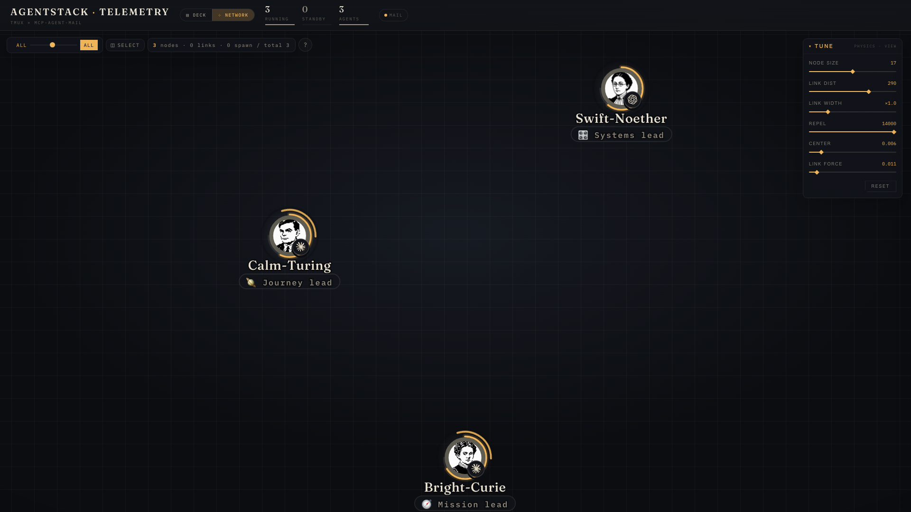

### Node

- 1ノードが1エージェントです。肖像の横の小さな badge は provider を示します。
- 肖像を囲む**系統色のリング**は spawn 上の立場です。色の対応は左上の `?`（凡例）で parent / child / both と確認できます。`both` は、親から仕事を受け、さらに子へ委任している中間ノードです。
- 外周の円弧は**残りの作業メモリ（context remaining）**です。最大270度で、短くなるほど残量が少ないことを示します。
- hover、または touch で長押しすると task、live state、model、last activity が出ます。
- ノードをクリックすると詳細パネルが開きます。tmux 型 agent は、そこから `OPEN TMUX` をクリックして該当 terminal へ移動できます。

詳細 panel の History は transcript と24時間 event sparkline、Output は project-scoped な成果物です。ROLE ASSIGN では role / group annotation を保存または削除できます。

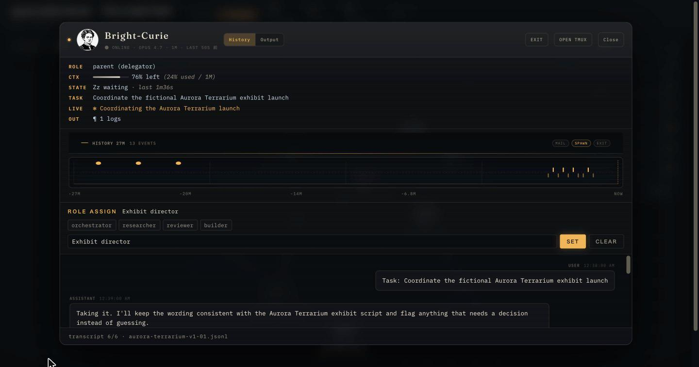

### Edge と mail

- spawn edge: parent-child lineage
- communication edge: ORRERY Mail message
- communication edge 上の数字: その2者間の通信回数
- communication edge の矢印: 通信方向
- edge click で二者間 mail drawer
- drawer に subject、importance、時刻、本文
- live message は comet animation

次の画像は、12ノードに `6 links · 6 spawn` ができた段階です。系統色のリングで親・子・中間を見分け、線上の `1` からその組み合わせの通信が1回だと読めます。

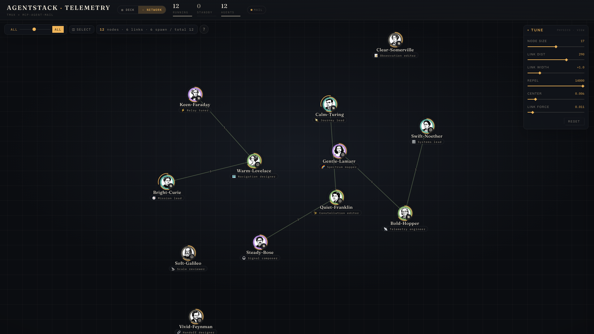

通信が増えると、同じ2者間の線上の数字も増えます。次の画像では `29 links · 9 spawn` となり、中央付近に `2` や `3` が見えます。数字はノード数や子の数ではなく、**通信回数**です。

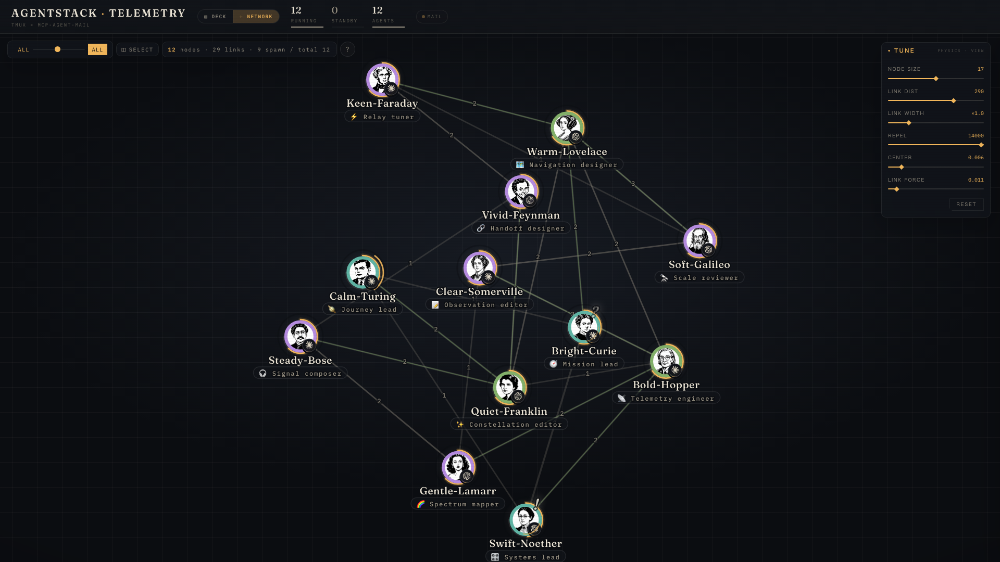

`AGENTSTACK_PROJECT_KEY` / `AGENTSTACK_VAULT` がないと mail edge と drawer は `NOT CONFIGURED` になります。tmux telemetry は残るため、mail 設定不足と dashboard 全停止を区別できます。

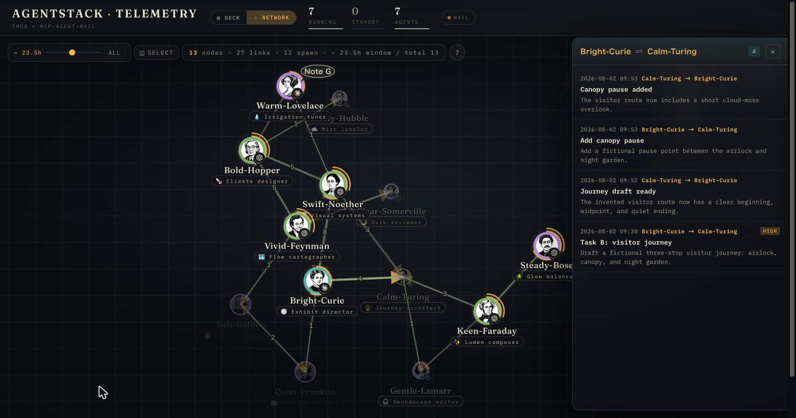

### 表示制御

- time window slider / ALL
- legend
- node search
- SETTINGS › NETWORK: `NODE SIZE`、`LINK DIST`、`LINK WIDTH`、`REPEL`、`CENTER`、`LINK FORCE`。header 右端の `SETTINGS` で開く drawer の slider でノード同士の配置を見やすく調整
- 値は `localStorage` に保存。同じ drawer の APPEARANCE で dark / light / system も切り替えられる（単体で開いたとき。[cockpit](https://github.com/gyroid-eth/orrery) に埋め込んだときは cockpit が決める）
- 300 node 超で dense mode

dense mode は label、annotation、provider badge、context arc を隠し、大規模 graph の描画負荷を抑えます。

## SELECT と一括操作

SELECT mode では drag rectangle または node click で複数選択できます。

| 操作 | 対象 | 動作 |
| --- | --- | --- |
| EXIT | running / finished | `/api/exit` で graceful `/exit` |
| RESUME | gone / retired | `/api/jump`。tmux がなければ transcript resume |
| REPLAY | mail history を持つ2 agent 以上 | DIGEST REPLAY |

EXIT / RESUME は二段確認し、60 ms 間隔で順次送信します。誤操作と service spike を避けるため、安全弁のない並列 request にはしません。

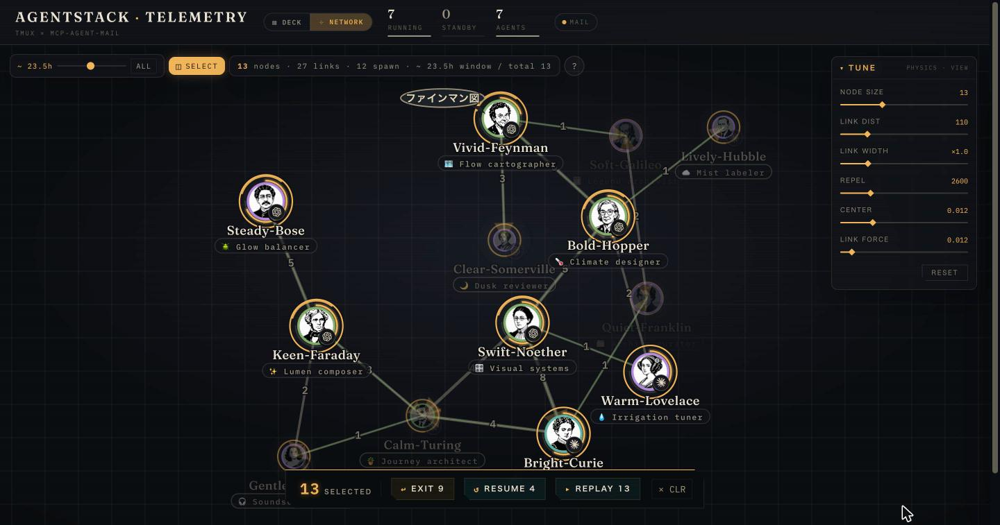

## DIGEST REPLAY

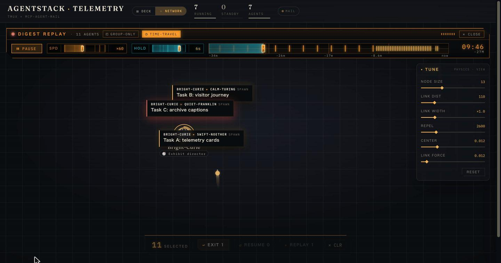

選択 agent の mail、spawn、exit / retire、承認待ち event を時系列再生します。

- play / pause
- seek と event marker
- absolute / relative clock
- 対数 scale の速度 `×1`〜`×10000`
- message card の HOLD `0.1s`〜`15s`
- GROUP-ONLY
- TIME-TRAVEL

TIME-TRAVEL ON は initial snapshot から node、edge、state を再構築します。OFF は現在 graph 上で comet だけを再生します。

履歴範囲は event の最古・最新へ auto-fit し、短すぎる範囲は操作可能な幅まで広げます。大量 event は topology と group 内 mail を優先して間引きます。

`Esc` / CLOSE で live graph snapshot と mail polling を復元します。

## NEW AGENT


`+ NEW AGENT` は identity、engine、directory、task を順に確認する launch manifest です。通常項目を一方向に並べ、parent / role / group / isolation は ADVANCED に畳むことで、standalone agent の起動を最短経路にしています。

### Identity

- `AUTO`: server が shared vocabulary から空き `Adjective-Scientist` を検証し、その explicit `name` を登録 request に送る
- scientist rail: portrait と `available / occupied / unknown`
- scientist 選択: `/api/suggest-name` が空き adjective を付けて live registry で検証
- SHUFFLE: 同じ scientist で別の verified name を再提案
- `occupied / unknown`: 選択不可
- roster 外または空き候補なし: HTTP 409 として別 scientist / AUTO を促す

scientist rail の `available` は bare surname ではなく、134 adjective のどれかとの組み合わせに空きがあることを意味します。adjective は ORRERY Mail 正典 `SIMPLE_ADJECTIVES` と同期し、client は local で未検証名を作りません。AUTO でも server が最大75候補を live registry で fail-closed 検証し、空きを確認できなければ spawn を拒否します。

### Engine

- provider tab（server の catalog から作られ、設定済みの環境では DeepSeek / Local も並びます）
- provider ごとの model card と用途 guide
- Claude は Sonnet / Opus / Haiku
- Codex の既定は起動対象 CLI が 0.159.0 以上なら `gpt-6.1-sol`、古い版なら `gpt-6-sol`（版不明なら新鮮な catalog で判定）。旧世代は `gpt-6-sol` など正式 ID で指定できます
- Codex の effort 候補は model catalog の `model_efforts` / `model_effort_defaults` に従います。明示 effort の最終可否は Codex CLI が判定します
- DeepSeek / Local は設定済み catalog の Model と Harness（dsh / Hermes）から選びます。model を選んで利用可能な harness を指定し、利用不可の項目は「Coming soon」と表示され、選択できません。Helper と Effort は選んだ model / harness の能力に従います。[設定手順](install.md)と[API reference](api.md)も参照してください。

server の provider / model / effort allow-list を catalog と validation の両方に使います。

この節は Telemetry 同梱画面の説明です。Model / Harness は cockpit と同じ英語の語彙を使いますが、directory dialog や Lineage の項目まで同一ではありません。OS の資格設定・memory・Local effort の範囲は[対応組合せと制限](managed-catalog.md)を参照してください。

<a id="native-models-and-harnesses"></a>
### DeepSeek / Local と dsh / Hermes

設定済みの provider、Model、利用可能な Harness を順に選びます。GIF は SPAWN の手前までです。[Model / Harness の選択操作を見る](img/native-harness-selection.gif)。

NEW AGENT の画像と GIF は、実際の catalog・科学者名・正規の肖像を使った Telemetry 同梱画面です。Claude / Codex / DeepSeek / Local models と dsh / Hermes の選択を起動前まで撮影し、作業ディレクトリと task は切り取っています。[cockpit の NEW AGENT](https://github.com/gyroid-eth/orrery/blob/master/docs/usage.md)とは画面が異なります。以下の DECK / NETWORK は引き続き合成データの表示例です。いずれも資格の登録や全組合せの通し受け入れを示すものではありません。


Local Qwen は六角形の中に Qwen のロゴを表示し、DeepSeek は接続先の badge を表示します。agent を比べるときは Harness も別に確認してください。


### Directory

`AGENTSTACK_SPAWN_DIRS` の preset chip と exact path input を表示します。preset は installer の `--spawn-dirs` で永続化します（shell の `export` は service に届きません。[configuration.md](configuration.md) の「Spawn directory」参照）。input は `/api/fs/dirs` の root-scoped typeahead で、arrow key / Enter でも選択できます。最後に使った directory は `localStorage` に保存します。

typeahead は `AGENTSTACK_SPAWN_ROOTS` の外へ出ず、hidden directory、`..`、root 外への symlink を候補にしません。

### Task と ADVANCED

task は必須、最大4000文字です。ADVANCED の開閉状態は `localStorage` に保存します。

- parent: 既定は `STANDALONE · independent agent`
- role: 任意、最大40文字
- group: 任意、最大24文字
- isolation: isolated worktree と base revision

parent を選ばないと `standalone: true` を送り、`PARENT_AGENT` のない独立 agent として起動します。parent を選ぶと通常 child になり、task を child inbox へ送り、parent を CC した audit trail を残します。

### Spawn 順序

1. `register_agent` で child identity と専用 token を作成
2. role / group annotation（best effort）
3. 通常 child だけ、parent を sender にして task message と CC audit trail を作成
4. token を mode `0600` の one-shot file に保存
5. `spawn_child.sh --pre-registered` を background 起動
6. launcher の readiness verdict を最大120秒待つ
7. live tmux session を再確認

失敗時は tmux session と token / child credential file を cleanup し、`dashboard/logs/spawn.log` の末尾を API error の `detail` に含めます。登録済み identity は server に削除権限がないため保持され、response の `registration_retained: true` で明示されます。

Codex では `--codex --model <model> --effort <effort>` を渡します。non-git directory の trust dialog は `C-m` で最大10回受理を試み、残り続ける場合は fail-fast します。

すべての POST は JSON body が必須です。browser は same-origin、CLI は `Origin` / `Sec-Fetch-Site` を付けない request だけを受け付けます。

### Isolated worktree

`worktree: true` では child ごとに:

```text
${AGENTSTACK_WORKTREE_ROOT:-$AGENTSTACK_HOME/worktrees}/<child-name>
branch: exp/<child-name>
```

を使います（通常の install root は `~/.agentstack`）。`AGENTSTACK_WORKTREE_ROOT` は installer 実行時に環境変数で上書きできます。`worktree_base` を省略すると `HEAD` です。task message には元 project key、branch、base、directory を明記し、worktree path を ORRERY Mail project key と誤認しないようにします。

## Embed mode

`/?embed=1` または same-origin iframe では compact header の embed mode になります。[ORRERY cockpit](https://github.com/gyroid-eth/orrery) は、header の `TELEMETRY` からこの mode で dashboard を埋め込みます。

操作に追従する host の checklist 向けに、成功した操作だけを same-origin parent へ通知します。通知の型・成功条件・受信側の検証は [Embedded interaction notifications](embedded-tour-events.md) にあります。単独表示では通知しません。

parent window から:

```js
frame.contentWindow.postMessage({type: "net-pause"}, location.origin);
frame.contentWindow.postMessage({type: "net-resume"}, location.origin);
```

を送れます。

- `net-pause`: DECK / NETWORK / mail health polling を停止
- `net-resume`: polling を再開し、現在 view を即 refresh

hidden iframe が tmux / SQLite を継続 polling しないための契約です。message は same-origin だけを受け付けます。

### Theme axis bridge

same-origin の parent は、dashboard だけに1軸の A/B override を送れます。parent 側が選択履歴と preset を所有し、iframe は永続化しません。

```js
frame.contentWindow.postMessage({
  type: "agentstack-theme-axis",
  version: 1,
  axis: "glow",
  value: 1,
}, location.origin);
```

`axis` は `dim-contrast`、`small-text`、`tracking`、`glow`、`background` のいずれかです。数値は finite かつ `0 <= value <= 1` でなければならず、範囲外は clamp せず `invalid-value` として reject します。`null` は override style node と一時属性を物理的に除去します。初期表示は bridge の CSS を一切適用しないため、従来の描画経路のままです。

receiver は `event.source === window.parent` と `event.origin === location.origin` の両方を確認します。処理した request には parent へ次の envelope を返します。

```js
{
  type: "agentstack-theme-axis-result",
  version: 1,
  ok: true,
  requested: {axis: "glow", value: 1},
  state: {axis: "glow", value: 1},
  source: {unit: "declaration", expected: sourceRecords.length, matched: sourceMatched},
  mutation: {unit: "effect-component", expected: snapshot.length, applied: appliedCount},
  effect: {unit: "effect-component", evaluated: 30, changed: 26,
    rendered: 28, inViewport: 26, visibleExpected: 26,
    visibleReached: 26, visibleChanged: 26, deferred: 4},
  reason: null,
}
```

上の識別子は envelope の対応関係を示す擬似コードです。正本は [`scripts/dashboard_theme_manifest.py`](../scripts/dashboard_theme_manifest.py) が `dashboard/index.html` から生成する [`dashboard/theme_effect_manifest.json`](../dashboard/theme_effect_manifest.json) と、そこから生成して HTML に埋め込む runtime inventory です。前者は selector / property / line / component を含む review 用 record、後者は同じ record の安定 ID list と規則/source digest を持ちます。runtime の `source.expected` は軸ごとの `records.length` から導出し、独立した数値定数を持ちません。CSS を変更したら次を実行し、record list、規則 digest、source digest の差分を一緒に review します。

```bash
python3 scripts/dashboard_theme_manifest.py --write
python3 scripts/dashboard_theme_manifest.py --check
```

`source` は token / declaration の coverage、`mutation` は apply 直前の immutable snapshot から導出した token-write / element / effect-component の compiled 適用数です。source unit は軸ごとに厳密で、`dim-contrast` / `background` は `token-write`、`small-text` / `tracking` / `glow` は `declaration` です。`effect` の membership は generated eligibility の pre-apply live match だけで固定し、適用前・適用後・endpoint の値から対象を増減しません。そのうち rendered・nonzero box・viewport 内を `visibleExpected`、cascade 後の computed が requested derivation へ到達したものを `visibleReached` と数えます。元から requested 値だった member も reached です。`visibleChanged` は可視 member の canonical post が pre と異なる数、`changed` は全 evaluated member の同じ差分を数える独立 no-op gate です。hidden / zero-box / offscreen は `deferred` に数えます。non-null apply は `visibleExpected > 0`、`visibleReached === visibleExpected`、`visibleChanged > 0`、`changed > 0` をすべて満たす場合だけ成功します。0や量子化以下は `no-effective-change`、可視対象0は `no-visible-targets`、requested derivation に到達しない member があれば `effect-count-mismatch` として reject し、直前の valid axis を復元します。面や単位を合算しません。`glow` の effect unit は live `effect-component` です。同一 surface に対象 radial layer が2つあれば2件と数え、CSS rule 1件が可視 element 10件へ match すれば10件と数えます。selector と keyframe の source component は `emissive | elevation | focus | state` に分け、色 halo だけを弱めて elevation と focus を維持します。

embed初期化/reload後は`agentstack-theme-axis-ready`（version 1、surface `telemetry`）をsame-origin parentへ通知します。従来のVision profileメッセージ受け口は廃止しました。上記の単一axis契約は維持します。

## Terminal bridge

カードまたは node から terminal を開くと、server は Ghostty / iTerm2 / Terminal.app への jump、または browser terminal 用 `ttyd` を確保します。

`AGENTSTACK_BIND_HOST=0.0.0.0` は terminal bridge と control endpoint も外部へ公開します。dashboard に認証 layer はないため、trusted LAN / VPN 以外では使わないでください。

legacy dashboard の Host 検査は既定で実待受ポートの loopback だけを許可します。LAN / VPN の URL を使う既存利用者は、更新前に [`AGENTSTACK_DASHBOARD_ALLOWED_ORIGINS`](configuration.md#lan--vpn-から使う場合の-host-設定) で固定 origin を指定し、installer で保存・service へ反映してください。wildcard bind 自体では外部 Host を許可しません。通常の loopback 接続の cockpit bridge は設定追加不要です。この検査は認証を追加するものではありません。

## デモ（サーバー不要）

公開デモ [agentstack-demo.pages.dev](https://agentstack-demo.pages.dev/) は、この `index.html` そのものを Python も SQLite も tmux も無しで動かしたものです。コピーは作っていません。画面を動かしている通信は `fetch` による GET だけなので、`dashboard/demo/demo_api.js` が `fetch` を横取りし、台本（`story_*.js`・配役・生死・mail 本文・作業ログ）から時刻に応じた応答を組み立てます。書き込み系 API は無効です。

- `http://127.0.0.1:8770/?demo=1` で、手元の dashboard でも同じデモを再生できます（`demo_tour.js` が字幕と対象のリングを重ねるだけで、製品の挙動は変えません）
- 台本の書き方は [`dashboard/demo/STORY_CONTRACT.md`](../dashboard/demo/STORY_CONTRACT.md)。公開してよい肖像の台帳は `PORTRAITS_CLEARED.txt` で、build はそこに無い肖像を同梱しません
- 静的 bundle は `bash dashboard/demo/build.sh [outdir]` で作り、どのパスに置いても動きます。全 script に内容ハッシュの版番号を付けるので、CDN の古い写しと新しい HTML が組になる壊れ方をしません

## 関連文書

- [Hooks と運用 helper](hooks.md)
- [Codex App 統合](codex-app.md)
- [API reference](api.md)
- [設定](configuration.md)
- [トラブルシューティング](troubleshooting.md)

<a id="global-mail-view"></a>
## 隔離 global mode の Mail 表示

既定は旧 mode のままです。隔離 global server と operator capability を準備した場合だけ、global dashboard が開きます。[解除と Lock](global-delivery-client.md#operator-ui-access)の手順を使い、agent の owner token は貼り付けないでください。画面は対応する capability を確認します。

`View as` で数値 identity を選び、NETWORK の edge を開くと、その視点で見える Mail を同じ右欄で読めます。返信は `reply_to` の message ID で結びます。長い返信も字下げを増やし続けず、返信先のリンクから辿れます。本文は literal text として表示し、埋め込まれた HTML を実行しません。見えない前の Mail は短い案内だけにし、不可視の ID・本文・宛先を補いません。`Load more visible mail` は server の keyset cursor をそのまま使います。

保存する URL は `?view=net&view_as_agent_id=ID&message_id=ID` です。旧 numeric `thread_id` は可視の origin へ変換し、旧 label は source ごとの群を保ちます。件名から返信を推測しません。新旧 ID の矛盾は拒否します。

古い指示があれば Mail 欄に短い英語の案内と `Details: English / 日本語` を出します。片付けは command のコピーまでで、自動削除しません。Dismiss はこの page session の同じ finding を隠すだけです。Settings からいつでも確認でき、path・block hash・版・状態が変われば再表示します。60秒ごとと明示確認時に更新します。埋込表示では host 側の案内にまとめます。詳細は[既存 block の移行](instruction-migration.md#legacy-blocks)へ。起動時の候補の観測は、実際に読み込まれた指示の証明ではありません。

MAIL の `signal.status` は配送の健康です。server readiness と別の値なので、配送が red でも server が受け付けられる要求は使えます。登録一覧から process の活動を推測せず、確認できない session 状態は unavailable と表示します。

NEW AGENT は固定 client slot を使います。同じ名前は既存 identity の resume を案内し、資格情報を再発行しません。設定・trust が不足したら表示された operator 操作へ戻ります。最近の folder は10件、古い scalar は1回だけ移して削除します。folder は作業場所であり Mail の scope ではありません。folder browser は既存の `AGENTSTACK_SPAWN_ROOTS`、成果物は明示 `AGENTSTACK_DELIVERABLE_ROOTS` だけです。成果物未設定なら空と案内し、cwd・project へ fallback しません。

旧 mode の画面と経路は維持します。cockpit の global bridge と右 pane への結線は後続です。新 dashboard と旧 cockpit の組合せでは旧 cockpit の表示を使い、global の画面 capability を推測して有効にしません。

global network の稼働状態は `ACTIVITY UNKNOWN` と表示します。実際の working/waiting・ctx・親子を表示する read 投影は PR7 の切替前に必須です。

登録の回復ボタンは status の `next_operations` に従い、再送・finalize・configure を同じ slot と intent で続けます。Resume は既存 launch の操作です。登録再送と abandon は表示した pending の digest を照合します。Lock は進行中の fetch を中止し、遅い body と tab の capability 引継ぎを失効させます。新 tab は自分の request と一致する500ms以内の返信だけを採用し、Lock 後は明示 Unlock が必要です。storage 拒否時は `BROWSER_SESSION_STORAGE_UNAVAILABLE` を表示して page memory だけで動作し、reload 後は再入力します。

指示の確認は local context の identity で slot を選び、一致した slot だけを server と照合します。配置元は slot の `wrapper_root` が唯一の正本です。Claude/Codex の provider slot を証明できない agent の `PROVIDER_HOME_UNPROVEN` は Settings だけで表示し、会話に毎回案内を重ねません。コピーする cleanup command は検出に使った HOME・provider HOME・install の env を明示します。この指定を外して旧 block を消さないでください。

Lock は drawer の見出し・件数と accessibility 状態も初期化します。configure-provider ボタンは指示 block の配置が必要な場合だけです。Codex trust の承認と daemon の実行設定は日英の CLI 手順へ案内し、profile 不在は `PERSISTENT_EXECUTION_REQUIRED` と表示します。

<a id="global-runtime-observation"></a>
### global network の稼働状態

API 18 の `global_runtime_observation=1` は、既存の私有 client root と管理 socket の本人照合から、network の working / waiting・context 使用率・親子の色を読み取ります。旧 mode の表示と既定の導入は変わりません。観測のための登録・ファイル作成・Mail DB の直接読取は行いません。

各 root の既存 operation mutex を共有・非待機で取得します。writer が使用中、本人・世代・binding が不一致、PID/start/pane の証明が不明なら、その agent だけ `ACTIVITY UNKNOWN` です。応答全体の期限は5秒。pane の揮発 cache は最大4.5秒で、本人・binding・live slot の変更で失効します。複数 session が同時に生きている場合は `MULTIPLE SESSIONS` とし、activity と context を合成しません。終了済みの履歴は現在の session を隠しません。

Codex App の snapshot と Desktop session meta は現在の provider の生存証明ではありません。App の activity / context は **unknown / null** のままです。bridge・wake・snapshot の記録方式は変えません。親子は既存の typed child-state を本人照合し、名前や Mail の往復から推測しません。

共有 browser controller は capability・Lock・Mail の表示・登録回復を1か所で扱います。Lock は進行中の要求と画像 URL を失効させます。sessionStorage はそのページに権限を持つ拡張機能から読めるため、信頼できる browser profile を使ってください。Lock はその page session の解除であり、server の capability の撤去ではありません。

Mail の視点を選ばなくても network と deck に同じ稼働状態を表示します。不在を確認できたものは NOT RUNNING、確認できないものは ACTIVITY UNKNOWN です。親子は直接の関係を表示し、退役した祖先だけを理由に孫の関係を消しません。

<a id="global-runtime-proof"></a>
### 対応能力の確認

一時 HOME の隔離 server/dashboard を準備し、既存の [operator capability](global-delivery-client.md#operator-ui-access) を明示的に設定した後で実行します。

```sh
AGENTSTACK_HOME="$TEST_HOME/agentstack" \
AGENTSTACK_GLOBAL_SERVER_CONFIG="$TEST_CONFIG" \
ORRERY_DASHBOARD_URL="http://127.0.0.1:$TEST_PORT" \
agentstack-http-operator probe --service telemetry
```

capability は内部で読み、引数・URL・結果に出しません。結果の `binding`・`telemetry_api`・`capabilities` を確認します。6r だけでは `cockpit_ready=false`、`cutover_ready=false` が正常です。cockpit の実装後は同じ command に `--service cockpit` と既存の `PORT` 環境変数を使います。cockpit の port の永続 file / 設定 key は追加しません。PR7 の切替は別の関門です。この probe の成功だけでは切り替えません。

確認には合成の work / wait、context 0 / 42 / 100、standalone、親子、複数 session、writer 使用中、App unknown を用います。実 provider の binary は不要です。PID/start/tmux の実機証明は専用の試験 socket で行い、live の dashboard・Mail・tmux は使いません。

probe の origin は CLI の既定・docs とも `127.0.0.1` を使います。`localhost` は別 Origin なので代用しません。環境の HTTP proxy は使用しません。

観測だけの失敗では、その回の稼働状態をすべて `ACTIVITY UNKNOWN` に戻し、Unlock・Mail・新規登録は利用できます。認証拒否（403）は従来どおり Lock します。1回の観測 HTTP 要求では roster と client root の列挙を各1回だけ行い、対象 ID と親の照合で共有します。200 ID を超える場合は要求ごとに再列挙します。永続 cache は作らず、15秒の更新間隔は変えません。
