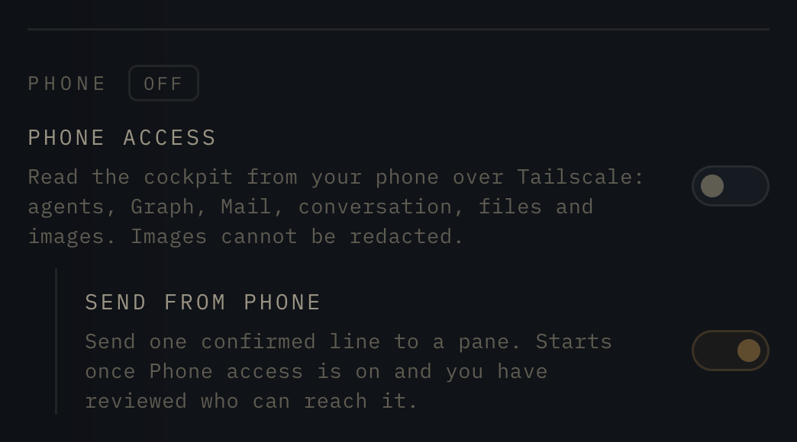
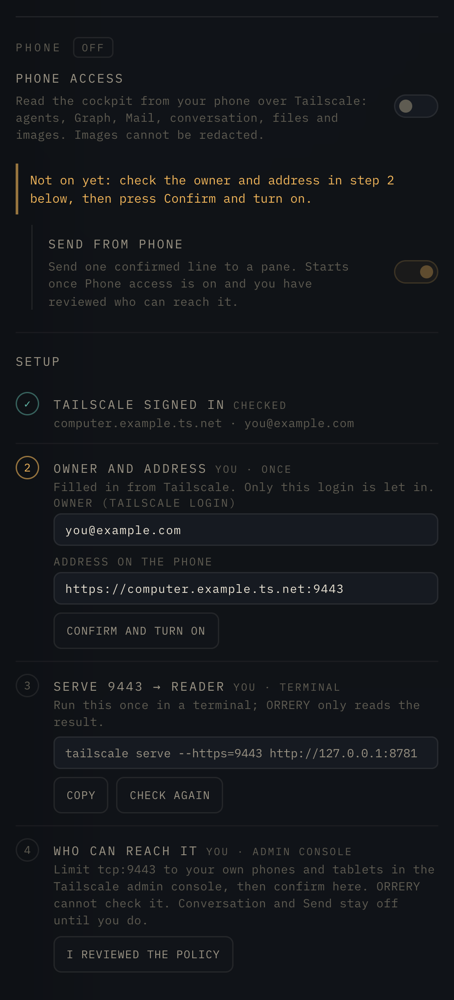
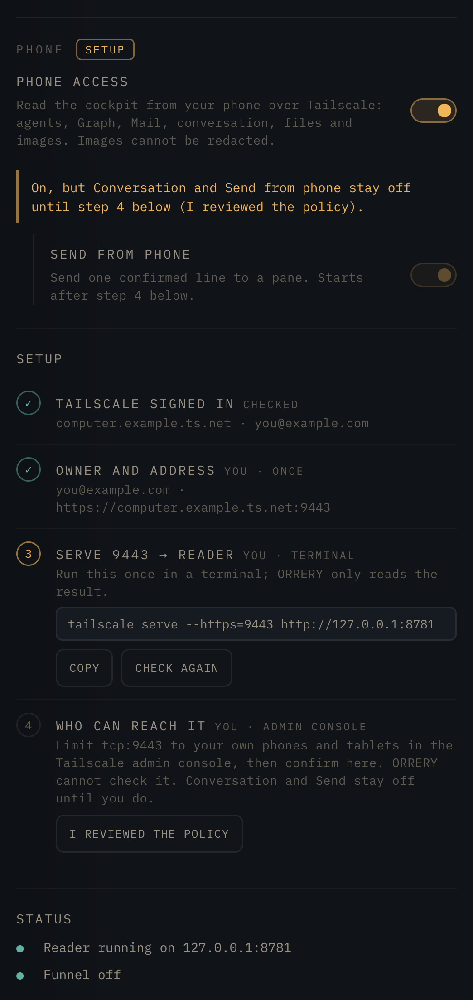
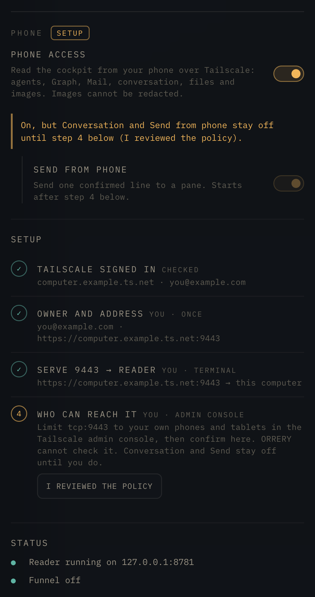
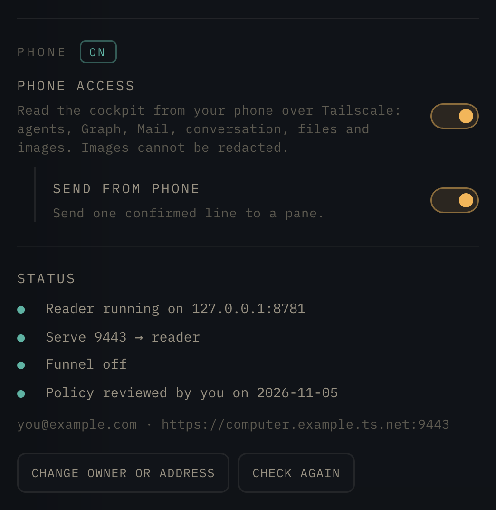
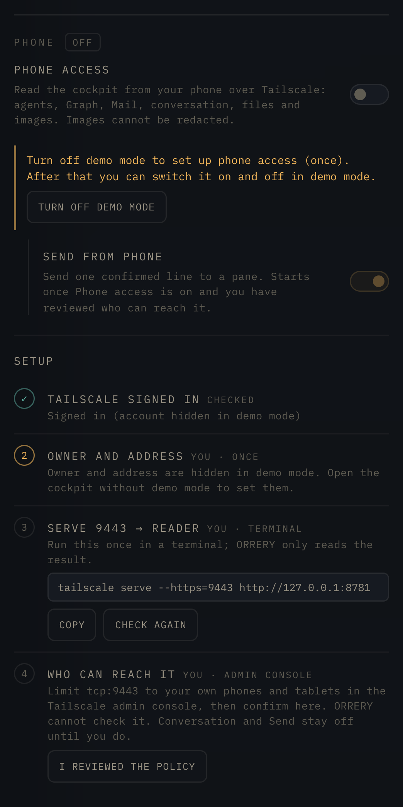
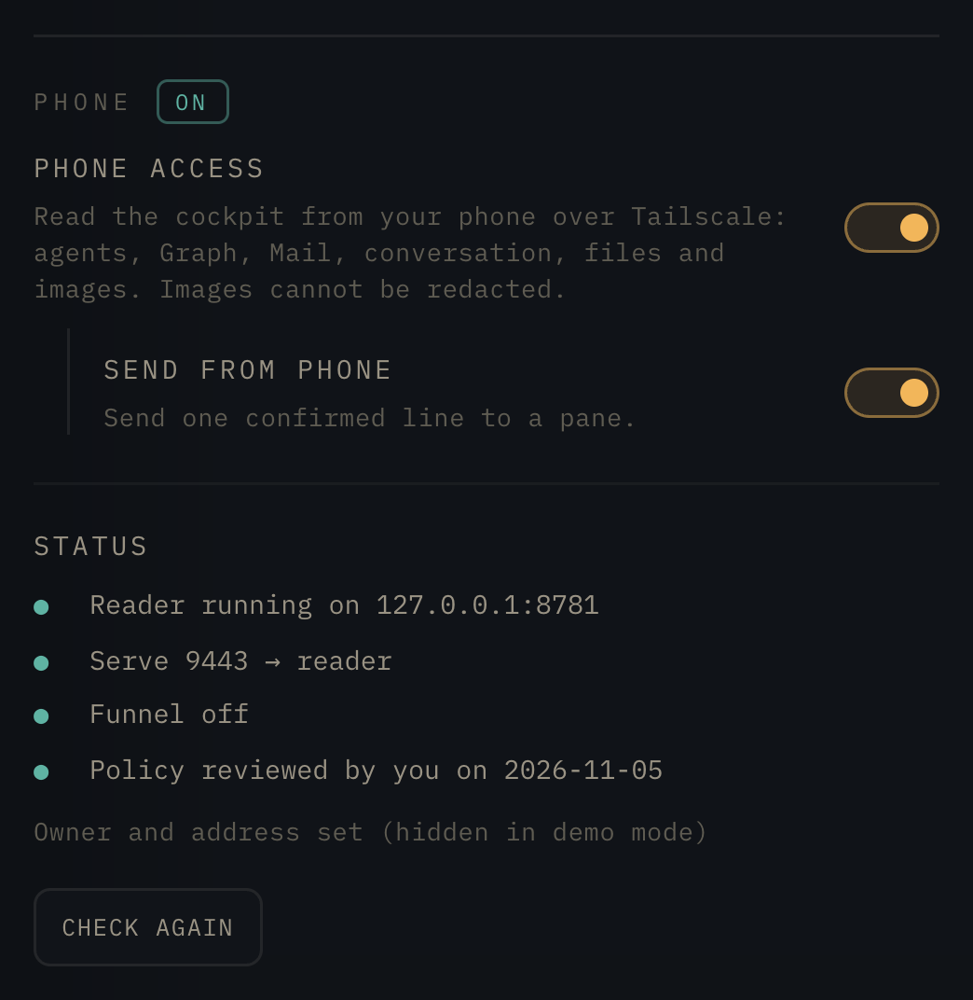
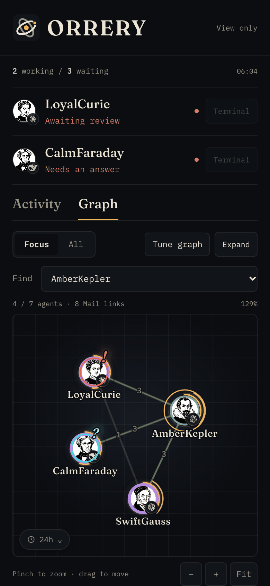
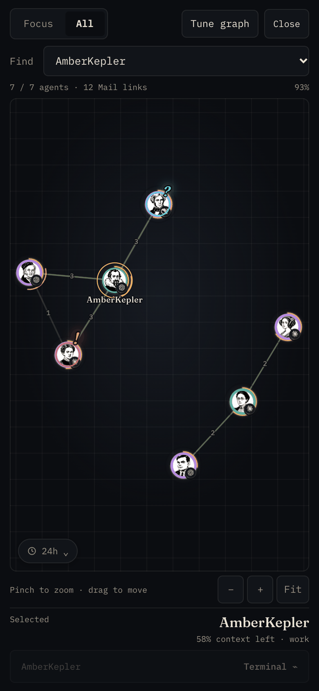
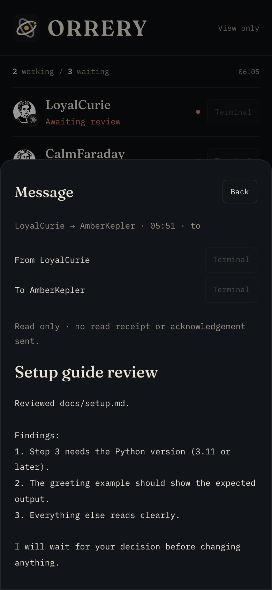

# Read Telemetry on your phone

> 日本語: [mobile.md](mobile.md)

[README](../README.en.md) · [Installation](install.en.md)

The mobile reader shows agents needing attention, a Mail timeline and NETWORK in English with a dark theme. **It is off by default.** Normal installation and updates start neither a listener nor Tailscale Serve. It reads legacy Telemetry on the same computer, using API 30 or later. Global mode is not supported.

With the ORRERY cockpit you can turn it on and off from **Settings → Phone** ([next section](#turn-it-on-from-cockpit-settings)). The table after it and [Enable manually](#enable-manually) are for setting it up by hand without the cockpit.

## Turn it on from cockpit Settings

The cockpit's **Settings** has a **Phone** section with two switches:

- **Phone access**: everything the phone can read (the agent list, Graph, Mail and conversation records, and file and image previews). There is no separate switch for conversations.
- **Send from phone**: send one confirmed line to a pane ([Terminal](#inspect-a-pane-and-send-input-from-your-phone)). It is on by default but does nothing until step 4 below.

**It cannot be set up in demo mode.** Demo mode does not put the login and the address on the page, so step 2 shows no fields. Turn off **Demo mode** in Settings once and go through step 4 below (`?demo=0` in the URL affects only that page; reloading brings demo mode back). After that you can go back to demo mode ([In demo mode](#in-demo-mode)).

The names and addresses in these screens are made-up examples; yours come from your own Tailscale.

### Before you start (you, once)

Two things cannot be changed from the cockpit. They are the same as steps 2 and 4 in the table under [Ask your agent to set it up](#ask-your-agent-to-set-it-up).

- **Install Tailscale on the phone and sign in with the same account as the computer.** Check: the computer is listed in the phone's Tailscale app (and the phone shows up in `tailscale status` on the computer).
- **Enable MagicDNS and HTTPS Certificates on the DNS page of the Tailscale admin console.** Serve (HTTPS) in step 3 needs them. Check: both are on in the admin console's DNS page, or `CertDomains` in `tailscale status --json` on the computer is not empty.

### The first screen

The badge next to **Phone** says **OFF**. Press the **Phone access** switch.



### Steps 1 and 2: Tailscale, owner and address (you, once)

The first press **leaves the switch off**. Right under the switch it says "Not on yet: check the owner and address in step 2 below, then press Confirm and turn on.", the **Setup** steps open below, and the cursor moves to step 2.

- Step 1 reads whether Tailscale is signed in. With a ✓ there is nothing to do. Without one, the line under the switch says "sign in to Tailscale" (or "Tailscale was not found" when it is not installed): install Tailscale on this computer and sign in, then press **Phone access** again.
- In step 2, **Owner (Tailscale login)** is the only login the reader lets in, and **Address on the phone** is the address the phone opens (`https://<this computer's Tailscale name>:9443`). Both are filled in from `tailscale status`; check them and press **Confirm and turn on**. This is what turns Phone access on.
- **Check:** the badge says **SETUP** and step 2 has a ✓.



### Step 3: Serve 9443 → reader (you, terminal)

**Copy** the `tailscale serve --https=9443 http://127.0.0.1:8781` shown in step 3, run it once in a terminal, then press **Check again**. ORRERY only reads Serve and never changes it.

**Check:** **Check again** puts a ✓ on step 3. If it does not, read the output of `tailscale serve`. With HTTPS Certificates off, it asks you to enable them here ([Before you start](#before-you-start-you-once)).



### Step 4: Who can reach it (you, admin console)

When step 3 has a ✓, check in the Tailscale admin console who and which devices can reach tcp:9443 (for example with the [device restriction below](#restrict-the-account-and-the-phone-separately)). Then press **I reviewed the policy**. Only the date you pressed it is kept; ORRERY cannot check the policy.

**Until step 4, conversations and Send stay off.** The phone can read the agent list, Graph and Mail only (the reader answers `policy_not_reviewed`). Meanwhile the line right under the switch says "On, but Conversation and Send from phone stay off until step 4 below".

**Check:** ORRERY cannot check the policy, so check it yourself. In every case, see in the admin console that only the people and devices you mean to allow can reach tcp:9443. If you restricted devices, also check that an excluded device cannot open it, as in [Verify on real devices](#verify-on-real-devices).



### When it is on

The badge says **ON** and the setup steps are gone. **Check it yourself:** all four Status lines are green (reader, Serve, Funnel off, policy). To change the login or the address, use **Change owner or address**.



### Conversations on the phone

On the phone, open the **Address on the phone** from step 2 (`https://…:9443/`) and open an agent. The first HTTPS request can take a few seconds while the certificate is issued. When the **Conversation** tab appears, conversation records reach the phone ([Read an agent's conversation history](#read-an-agents-conversation-history-on-your-phone)).


### In demo mode

If you press **Phone access** in demo mode before the login and address are set, the line right under the switch says "Turn off demo mode to set up phone access (once). After that you can switch it on and off in demo mode." **Turn off demo mode** turns demo mode off and reloads the page. Settings closes, so open **Settings** again, press **Phone access**, and go through the steps above.

Once it is set up, you can go back to demo mode and the switch keeps working. The login and the address read "hidden in demo mode" and are not put on the page. Turn demo mode off only to change them.

 

### What runs behind it

Behind it runs Telemetry's `~/.agentstack/bin/agentstack-mobile`. The cockpit only calls that command and never writes Telemetry's files itself.

- Settings live in `~/.agentstack/mobile.json` (mode 0600): `access`, `send`, `owner_login`, `public_origin`, `policy_reviewed_at` and three ports. It holds no keys or tokens.
- The reader runs as the launchd job `org.agentstack.mobile-relay`, as `mobile_relay.py --config ~/.agentstack/mobile.json`, logging to `~/.agentstack/logs/mobile-relay.log`. A change reloads the job; turning Phone access off removes the job and its plist. Installation only places the command and creates no job. Uninstall stops the job and removes the plist.
- While a reader you started by hand holds 8781, the badge says **MANUAL** and Status says **A reader not started from Settings is running on 127.0.0.1:8781**. The phone can still read that reader. Settings cannot control it, so its switches are disabled, and `agentstack-mobile apply` answers `port_in_use` and changes nothing. To move to Settings, stop that reader in the terminal that started it (Ctrl-C), then turn **Phone access** on. The hand flags map like this: `--enable-terminal` is **Send from phone**, `--phone-policy-reviewed` is **I reviewed the policy** in step 4, and History is part of **Phone access**.
- **Send from phone** also switches the cockpit side at once and saves it as `enable_mobile_terminal` in `~/.orrery/config.json`; no backend restart is needed. A change made in a terminal (`agentstack-mobile off`) is picked up the next time Settings is opened. While a reader started by hand is running, and until Settings has been used once, `enable_mobile_terminal` is left as it is.
- Changing the login or the address withdraws the step 4 review; conversations and Send stop until you review again. To withdraw it yourself, run `echo '{"policy_reviewed": false}' | agentstack-mobile apply`.
- If launchd cannot start the reader, Phone access goes back off and neither the job nor its plist is left behind (so nothing starts by itself at the next login).
- The job runs the reader with the Python that was in use when you turned it on. If that Python goes away (a venv, or an older Homebrew version), Status says **The Python this reader was set up with is gone**. Turn Phone access off and on to rebuild the job with the current one.
- In cockpit demo mode the Phone section does not put the login, the address or the Serve URL on the page (demo mode itself hides only user and host names). Turn demo mode off to set them up or change them ([In demo mode](#in-demo-mode)).
- Tailscale Serve and Funnel are only read. It warns when Funnel is on. It never changes the policy or Serve.

Without the cockpit, use `agentstack-mobile status` to see the state, `echo '{"access": true, "owner_login": "owner@example.com", "public_origin": "https://computer.example.ts.net:9443", "policy_reviewed": true}' | agentstack-mobile apply` to turn it on, and `agentstack-mobile off` to turn it off.

## Ask your agent to set it up

You can hand this page to the Claude Code or Codex agent on the computer that runs Telemetry. For example:

> Read docs/mobile.en.md and set up the mobile reader for my phone. Do the commands yourself, stop at the steps marked "you", and tell me exactly what to do there.

At steps marked **you**, use the Tailscale admin console or the phone itself. The agent can handle the other steps. To use Terminal too, continue with the [separate opt-in steps](#inspect-a-pane-and-send-input-from-your-phone) after setting up viewing.

| Step | Who | What |
|---|---|---|
| 1 | agent | Confirm `curl -s http://127.0.0.1:8770/api/version` reports API 30 or later |
| 2 | **you** | Install Tailscale on the phone and sign in with the same account as the computer |
| 3 | agent | Find the values: computer Serve name and IP from `tailscale status --json` (`Self.DNSName` without the trailing dot, `Self.TailscaleIPs[0]`), owner login from `User[Self.UserID].LoginName`, phone IP from `tailscale status`. `tailscale whois <phone IP>` confirms the phone belongs to that login |
| 4 | **you** | In the admin console, DNS page: enable MagicDNS and HTTPS Certificates if they are off. `CertDomains` in `tailscale status --json` is empty until then |
| 5 | **you** | Review who can connect. Restricting access to your operating devices is recommended; multiple personal phones and tablets are fine. If you choose this restriction, adjust the grant and broader existing permissions as described below |
| 6 | agent | Run steps 2–5 of [Enable manually](#enable-manually) |
| 7 | **you** | Open `https://<Serve name>:9443/` on the phone. The first HTTPS request can take a few seconds while the certificate is issued |
| 8 | agent + **you** | Check each intended device. If you chose device restrictions, also check that excluded devices are refused (see [Verify on real devices](#verify-on-real-devices)) |

On macOS the CLI is usually `/Applications/Tailscale.app/Contents/MacOS/Tailscale` when `tailscale` is not on `PATH`. A reader started by hand runs in the foreground. To keep it running, use cockpit Settings (or `agentstack-mobile apply`), which runs it as a launchd job.

## Reading the screen



- **Activity** lists sender, recipient, time and To/Cc only. Tap one Mail event to open its subject and body. Tasks and private paths are not separately fetched, but anything written in a Mail body is visible. Status records changes observed after this reader starts, rather than claiming to know when each change actually happened.
- **Graph** defaults to agents with observed activity in the last 24 hours. Focus shows the selected agent and up to five strongest peers within that period; All shows every agent in that period. Use Find, pinch to zoom, drag to pan, and Fit. Large graphs do not guarantee that every name is readable at once.
- Line width and arrow size follow Mail counts in the selected period. Counts are **recipient rows** by direction and To/Cc, rather than unread counts or unique sent messages. Dashed parent–child lines are separate from Mail.
- Context arcs and working motion use the PC renderer. Unknown context has no arc, and its sampling time remains unknown. Account usage is Unavailable; this reader never refreshes it.
- The six **Tune graph** controls adjust this browser's display only. Filtering Activity also changes only the view. There are no launch, stop or Mail reply controls. Conversation history needs the policy review below; Terminal viewing and input also need their own switch.

The reader polls about every ten seconds in the foreground and stops polling in the background. Failed observations retain the last known values, visibly marked as such; failure is never a healthy zero or a waiting agent. Snapshot time is the HTTP observation time. Mail shows up to 200 recipient events per page; **Older / Newer** replaces the page. Graph polling continues while you read an older page, without moving it back to the latest page. Status appears on the latest page only. Graph aggregation has a separate 10,000-link limit. Truncation is shown explicitly. Only six display settings are saved in the browser: no offline snapshot storage or service worker is used.

Tap a Graph Mail edge to open metadata between those two agents in the selected period. **Both** directions is the default; the sender→recipient buttons filter the direction. Parent–child lines do not open Mail. Tap one event for its content, **Back** for the list, and **Done** for Graph. Selection and zoom are retained.

While Graph is in the foreground, a rise in Mail link counts between snapshots (about every 10 seconds) sends a light from sender to recipient with a **+N** label. To/Cc rows for the same directed pair are combined. Tap the light for the existing pair list; subjects and bodies are fetched only when you choose one message. Initial load, period changes, returning from the background and interrupted observations do not replay older activity. Links outside the displayed graph are omitted; snapshots with truncated link counts do not produce lights. At most 12 lights appear at once. This is a difference in period counts: older Mail leaving a rolling window can offset new arrivals. With reduced motion enabled, a stationary mark appears at the link midpoint instead.

Use **Expand** at the top right of Graph to fill the screen. If the browser's fullscreen API is unavailable or refused, Graph fills the page instead. Find, Focus/All, Fit, pinch, drag, Mail-pair lists and the Terminal sheet remain available. **Close** restores the normal view. Back or Escape closes the foreground sheet first, then exits the expanded Graph. If the OS or browser exits fullscreen, the normal view returns and open sheets close. The layout follows orientation changes and retains your selection and manual zoom. Fullscreen, back gestures and keyboard behavior on an actual phone require separate acceptance.



Subjects are limited to 512 characters and bodies to 64 KiB of UTF-8, with explicit truncation notices. HTML and Markdown remain literal text; links, images and attachments do not execute. No read receipt, ACK or reply is sent. Closing, choosing another message, changing the period or view, and moving to the background clear the displayed content. Late responses cannot restore it. Unavailable, deleted, changed or expired events show an error, never the previous message's body.



After an owner-authenticated snapshot request, the Mac reader prepares a fixed last 24 h in memory: up to 2000 distinct messages and 32 MiB of serialized content plus metadata. This is a logical JSON byte budget, not an RSS guarantee. Multiple To/Cc recipients share one body. Capacity, time or read failures are shown as **partial / unavailable**, rather than complete coverage. Every tap rechecks the current delivery and revision, including cache hits. Older displayed events remain readable one at a time and are not cached. Stopping the reader clears all caches. Subjects and bodies are never bulk-sent to the phone.

Page positions expire after 10 minutes, with at most 256 on the host and 2000 issued events. The browser keeps at most 20 navigation positions. Expiry produces an explicit error rather than silently returning to the latest page. Changing the period resets pages and content.

The small time control at the bottom of Graph, or beside Activity's filters, opens **Time range**. Its slider covers 15 minutes to 30 days in 15-minute increments. It starts at 24 hours; **All history** is a separate explicit choice, distinct from Graph's All mode. Changes apply about 200ms after the last input. The period filters agent activity, Mail events and counts, and the observation time of Status changes. Status retains the latest 200 changes after reader start, then shows those matching the period and displayed agents.

Activity uses canonical last-active and Mail timestamps. Recently active retired agents remain included; merely running does not turn old activity into current activity. Agents with unknown activity times are excluded from finite periods with an explicit count, and included in All history. Observation and projection have limits; the host's large all-history reads are not guaranteed to finish within the deadline.

Special agent icons use the PC's existing portrait configuration, with a scientific portrait and then initials as fallbacks. The private map and file paths are never sent to the phone. Portraits require the same owner authentication, accept bounded PNG images, and fall back to initials on fetch or decode failure.

## Restrict the account and the phone separately

Use **Tailscale Serve inside your tailnet**, with neither Funnel nor direct sharing of the full dashboard or cockpit. The relay listens only on `127.0.0.1` and checks the outer HTTPS Host and exact owner login. [Serve replaces incoming identity headers with its own user information](https://tailscale.com/docs/features/tailscale-serve). Another process on the same computer can forge these headers; this is not protection from untrusted local processes.

**Matching the account does not restrict which devices can connect.** We recommend allowing only devices you use to operate the terminal; multiple personal phones and tablets are fine. Strongly consider excluding always-on, public-facing servers on the same account: they could also reach the terminal, increasing the impact if compromised. This is a recommendation, not a product requirement to use one device, and the product does not automatically verify the policy.

If you choose this restriction, have the administrator allow your operating devices' Tailscale IPs to the dedicated HTTPS port. Merge the following example into the existing policy, remove unused devices from `src`, and replace the placeholders. Do not overwrite the whole policy with it.

```json
{
  "grants": [{
    "src": ["<PHONE_TAILSCALE_IP>", "<TABLET_TAILSCALE_IP>"],
    "dst": ["<SERVER_TAILSCALE_IP>"],
    "ip": ["tcp:9443"]
  }]
}
```

[Grants and selectors are additive](https://tailscale.com/docs/reference/syntax/grants). A broader existing allow rule covering this port must also be narrowed; adding a phone-specific grant cannot subtract access. Listing the user and phone IP together in `src` is OR, not AND. See [IP selectors](https://tailscale.com/docs/reference/targets-and-selectors). Device names and browser User-Agent strings are not authentication. Do not substitute a tag on the user's phone: tagging changes its user identity.

Review **every grant and ACL** applying from excluded devices to this host, so no other broad permission still allows `tcp:9443`. For example, the following `ip` values remove only TCP 9443 from a broad grant while allowing the other TCP ports, UDP and ICMP:

```json
["tcp:1-9442", "tcp:9444-65535", "udp:*", "icmp:*"]
```

This illustrates [protocol and port syntax](https://tailscale.com/docs/reference/syntax/grants#network-layer-capabilities). It is not a replacement policy or a universal substitute for `["*"]`. Preserve any needed permissions for other protocols and destinations, and have the administrator review the changes. The agent does not rewrite policy automatically.

## Enable manually

**Before you update:** a reader you start by hand with `--phone-policy-reviewed` and without `--enable-history` shows conversation history and file and image previews on the phone after the first restart. To keep them off, add `--disable-history` before restarting. The reader also says so in one line when it starts.

1. Update Telemetry to API 30 or later and confirm that its normal local dashboard has observations. Keep the existing services and provider configuration.
2. Review current access. If you choose the recommended device restriction, complete that policy change above. Save the current `tailscale serve status --json` output and confirm that the example HTTPS port `9443` is unused and is not a Funnel listener. Do not reuse a port with existing configuration.
3. Check the options below. Replace `owner@example.com` with the exact Serve login and `computer.example.ts.net` with this computer's actual Serve name. Omit a trailing slash from the origin. Replace the script path for a custom installation. Python 3.11 or later is required.

```sh
python3 "$HOME/.agentstack/dashboard/mobile_relay.py" --check \
  --owner-login 'owner@example.com' \
  --public-origin 'https://computer.example.ts.net:9443' \
  --listen-port 8781 --upstream-port 8770
```

`--check` validates option syntax only. It makes no connections, starts no listener and changes no policy. It does not verify the phone restriction. Resolve missing options before continuing.

4. Keep the reader running in one terminal.

```sh
python3 "$HOME/.agentstack/dashboard/mobile_relay.py" --enable \
  --owner-login 'owner@example.com' \
  --public-origin 'https://computer.example.ts.net:9443' \
  --listen-port 8781 --upstream-port 8770
```

5. In another terminal, connect the dedicated Serve port to this reader. Do not point it at 8770 or cockpit.

```sh
tailscale serve --https=9443 http://127.0.0.1:8781
```

This uses the [Serve CLI](https://tailscale.com/docs/reference/tailscale-cli/serve) in the foreground and does not reset existing entries. Add `--bg` to keep the Serve entry after the terminal closes; remove it with the command in [Disable and restore](#disable-and-restore). A direct relay request without the owner header should return 403. If Host or Origin is rejected, check the actual Serve name, port and Tailscale version rather than relaxing the guard.

## Verify on real devices

Open `https://computer.example.ts.net:9443/` on each intended phone or tablet and confirm that the owner can load the page and snapshot. Also check that another account is refused. If you chose device restrictions, separately verify refusal from **excluded devices on the same account**. Owner-header authentication and device policy are separate checks. Do not report access as restricted to operating devices if the excluded-device checks are incomplete.

Repository tests use isolated HTTP and synthetic screens. They do not establish acceptance of the installed Tailscale version, real policy or actual phone. The operator performs that deployment verification separately.

## Inspect a pane and send input from your phone

**Terminal is a separate opt-in. For a reader started by hand, capture and input are off by default.** Starting the viewing reader alone does not enable it. In cockpit Settings this is **Send from phone**, on by default but inactive until the policy is reviewed. Device restrictions are the optional recommendation above; you can allow several operating devices. The existing `--phone-policy-reviewed` declaration is still required to acknowledge that the operator reviewed current access. It does not verify policy or enforce a single phone.

You can also give this section to your agent. It should stop at your steps and preserve existing settings.

| Step | Who | What |
|---|---|---|
| 1 | agent | Confirm Telemetry API 31 or later for legacy, a matching API34 version for fresh, the ORRERY pane adapter, and the current backend's launch method and manager |
| 2 | **you** | Review access. If you chose device restrictions, check allowed operating devices and refusal from excluded ones. Agree to the temporary disconnection during restart |
| 3 | agent | Add or update only the JSON field below in the existing `~/.orrery/config.json`, preserving other fields. File mode `0600` is recommended |
| 4 | agent | Explicitly stop and restart the backend through the identified launch procedure. Reusing a running process does not apply the setting. Do not start a duplicate or use blanket kills; stop and report an unknown manager |
| 5 | agent | Use the capability check below to confirm `api:31` for legacy or `api:34` for fresh, and `enabled:true` after human opt-in. It captures no pane and sends no input |
| 6 | agent | Add `--enable-terminal --phone-policy-reviewed --cockpit-port 8791` to the reader's existing launch example. Run `--check` with the same flags first, then restart the existing reader through its current manager |
| 7 | **you** | Open Terminal on your phone or tablet, check the selected pane and display, and review the exact text before every test send |

Add this field to the shared settings; the example does not replace the whole file.

```json
{"enable_mobile_terminal": true}
```

New backends started by `scripts/start-cockpit.sh`, setup reached through `get.sh`, or ORRERY.app read the same setting. Custom backend commands can still use `--enable-mobile-terminal`. **Closing ORRERY.app leaves the backend running.** If reopening the app does not apply the setting, restart the backend through its original manager.

The following check sends no input. Replace `owner@example.com` with the reader's owner login, and change the first path for a custom installation.

```sh
python3 - "$HOME/.agentstack/dashboard" <<'PY'
import sys
sys.path.insert(0, sys.argv[1])
from mobile_input import InputClient
capability = InputClient(8791, 'owner@example.com').call('capability')
print({key: capability[key] for key in ('api', 'enabled')})
raise SystemExit(0 if capability['enabled'] else 1)
PY
```

Do not treat `enabled:false` or an error as successful activation; check the version, settings and process manager. Reader `--check` validates syntax, not policy or device acceptance. Missing opt-ins, incompatible versions, existing target protection or unavailable OS identity checks leave Terminal unavailable.

The header says **Terminal enabled** when available. The selected Graph agent panel, Activity Status rows, attention rows and Mail-detail From/To entries have explicit **Terminal** buttons leading to the same sheet. Existing Graph selection and Mail-detail actions remain. Choose a pane when several exist; an unknown mapping is never guessed from the label. In legacy, only panes already handled by the PC manager on the same transport and admitted by its protection are eligible. Agent type and the displayed time period are not authorization. No other socket or global target is used as a fallback. A pane's session may be outside the current metadata project. For fresh, use the explicit I/A procedure below.

The selected pane shows its last 120 lines, limited to 12 KiB of UTF-8. With Conversation enabled, Terminal fills the reading surface and aligns short output at the bottom. Long lines wrap and continuation lines retain their original indentation (limited to 40% of the screen width for deeply nested output). Divider-only lines stay on one line and are clipped to the width. The frame is removed. Limits, update timing and Shown time appear in one small row below the text. Truncation, removed control sequences and paused reading appear below only when needed. A small dot marks activity, while paused reading and failures stay visible. Only that open, foreground pane updates about every three seconds; failures back off to 6, 12 and at most 24 seconds. Removed control sequences and shortened text are marked. Images, HTML and links never execute. Full recorder/restored history is not forwarded; the separate [History opt-in](#read-an-agents-conversation-history-on-your-phone) shows only verified conversation records. **Terminal text can contain keys or private writing.** Check it before sharing the screen.

Expanded terminal previews require `X-ORRERY-Mobile-Preview: 120/12288` on the loopback request. If either side is older, previews keep the 40-line/6-KiB limits; the newer reader validates text against the declared limits. Expanded responses still fit within 16 KiB of serialized JSON, shortening the tail further when quote escaping requires it. The relay sends UTF-8 without expanding non-ASCII characters into `\uXXXX`.

Swipe clearly left over Conversation text to open Terminal, or right over Terminal text to return. Gestures starting within 24 px of either screen edge are left to the OS. Vertical scrolling, text selection and horizontally scrollable tables or code keep their own behavior. Swiping does not switch tabs while input has focus, a draft exists, Review is shown, or a send is pending. An empty unfocused input does not block swipes over the body. The buttons in the top bar remain available.

While you scroll up to read, the text, **Shown** time and shortening/control-removal notes stay on the same snapshot; fetching continues. **New output · paused** means a newer tail is waiting. Scroll to the bottom to switch to the latest tail and resume following. This does not accumulate all output: if more than 120 lines or 12 KiB arrive while paused, output between the old display and the latest tail may be missing. On your phone, open a pane with flowing output, scroll up and wait more than three seconds: the line being read and its Shown time should stay fixed. Return to the bottom and verify that the latest tail appears. Also check that opening/closing the keyboard or rotating the screen keeps a following view at the bottom and retains the text when reading earlier output.

A successfully fetched empty snapshot is also held while reading; returning to the bottom switches to the empty display. A fetch failure is an exception: text, Shown and notes are cleared, and recovery starts at the latest tail. A size change that clamps the view to the bottom does not release the pause; scroll toward the bottom again to switch to the latest tail.

When an operation changes direction, its latest movement decides whether to resume. Reversing upward, using two fingers or cancelling a touch keeps output paused. Moving downward again can resume once the view is at the bottom.

Use a dedicated pane that is safe to test. Check that changing panes and reopening after Close start at the new tail, and that **Review input** → **Edit** retains the input and shows the correct pane and text. To test sending, use only a known recipient pane explicitly set up to accept a short test input without side effects. Verify the target, exact text and Enter, press **Send once** once, then check the response and receipt. Do not send test text to a working agent or an unfamiliar shell. Also check that backgrounding closes the sheet and clears its display, draft and confirmation, and that returning to the foreground and reopening Terminal starts at the new tail.

Conversation and Terminal share a persistent rounded input with a destination chip at the bottom. Write one line of at most 4 KiB UTF-8 and press **↑ (Review input)** to turn that same area into confirmation. Check the agent, window, pane, not-yet-sent notice, exact text and following Enter, then press **Send once** once. **Edit** returns to the draft without losing it. Image attachment controls are not available yet. Confirmation expires after 30 seconds. Output refreshes do not replace its text, target or expiry. A changed pane or failed preview requires a new review. Keep the sheet open in the foreground to see the pane's response after sending. **Received by terminal** means tmux accepted the batch, not that an agent ran or completed the task. **Outcome unknown** can mean that only part arrived; there is no automatic retry. **Check receipt** only queries its receipt.


This is a terminal operation you confirm by inspecting the pane. Changes of program or a return to a shell within the same pane are not guaranteed to be detected. Text may be interpreted by that shell, combined with existing input or another writer, or sent after the screen changes. The feature does not clear input buffers or interrupt the pane before sending.

Close, pane changes, backgrounding and leaving stop polling and clear the display, draft and unsent confirmation. Late responses cannot restore them. Content is not placed in URLs, logs, browser storage or a server preview cache. This does not erase existing PC recorder output or OS recording/screenshots. Actual Android keyboard behavior, Serve/phone policy and real panes need separate acceptance; isolated HTTP/CDP checks do not establish them.

To disable only Terminal, set the shared field to `false` or remove it, also remove any explicit `--enable-mobile-terminal` from custom backend arguments, and remove those three reader flags. Restart both processes through their existing procedures; leaving them running does not disable the feature. Viewing settings and unrelated Serve entries can remain.

## Read an agent's conversation history on your phone

Speaker headings show a portrait (initials when unavailable), a small provider logo, the agent name and the time. Mail uses the same portraits and logos, preserving the sender's name first. Multiple recipients show all portraits and names when they fit, switching to overlapping portraits and a remaining-recipient count `+N` when space is short. All recipient names remain in the title and accessible label. A peer outside the roster gets only a name, or counts toward `+N` in the portrait-only row. Decorative portraits and initials stay out of selections across messages. High and urgent use a small dot before the subject. Compaction summaries remain short activity lines, separate from human messages.

**History is part of Phone access and is on by default once the policy is reviewed (`--phone-policy-reviewed`, or I reviewed the policy in Settings).** **Before you update:** a reader you start by hand with `--phone-policy-reviewed` and without `--enable-history` shows conversation history and file and image previews on the phone after the first restart. To keep them off, add `--disable-history` before restarting. The reader also says so in one line when it starts. Without the review the reader still starts with History off, and `/view/history` answers `policy_not_reviewed`. It shows the read-only conversation record (Codex, Claude Code, dsh, Hermes) that cockpit has verified as the agent's own, and is an exception to "full history is not forwarded" only while History is on. To keep it off, add `--disable-history` to a reader started by hand. Settings has no conversation-only switch; turn Phone access off instead. With History on, the phone can also open the current contents of files and images inside the agent's working folder that the conversation's tool calls mention (preview below). There is no separate switch for this. **Nothing is hidden by name or masked:** what to show is the owner's call (see below). The agent can do the steps below; review access first.

| Step | Who | What |
|---|---|---|
| 1 | agent | Confirm Telemetry API 35 or later and that the ORRERY cockpit backend is running on the same computer (default port 8791). Cockpit reads the record; the reader does not |
| 2 | **you** | Review who can open the reader, as for Terminal. With History on, every device that can open the reader can read back through past conversations, not only a 120-line terminal tail, and open the current contents of files and images inside the agent's working folder that those conversations mention. Conversation text, file text and images reach the phone as they are, so they can contain keys or private writing |
| 3 | agent | Check that the reader's launch command has `--phone-policy-reviewed` (and `--cockpit-port` if it is not 8791). Run `--check` with the same flags first (it prints `conversation history and previews are on`), then restart the reader through its current manager. An existing `--enable-history` still works |
| 4 | **you** | Open an agent on the phone and check the **Conversation** tab. Tap a file chip ending in **›** and check that a preview opens and **Close** removes it |

When enabled, the header says **History enabled** (or **History · Terminal**) and the entry buttons become **History**. Opening an agent shows **Conversation full screen**, with a thin bar for portrait, name, state, Conversation/Terminal and **×**. Every bar button has a touch target at least 44 px square. When Terminal is enabled, the input and destination chip stay at the bottom. Opening the view does not focus input or open the keyboard. This guide holds the explanations; unverified records, disconnections and send failures remain visible. With no pane chosen, input and ↑ are disabled and a prompt asks you to choose one in Terminal. **×** closes the view; Back/Escape first closes a preview, then leaves focused input, and otherwise closes the view. The persistent input alone does not trap Back. **Working** adds the recorded turn duration only when available, such as **Working · 2m05s**; otherwise it says only **Working**. A short red row marks a reply needed.


- The phone sends only an agent name from the displayed roster and, for **Show older**, a page token the reader issued (valid for 10 minutes and renewed while the latest page is polled), and, to open a file, a reference ID the reader issued on the same terms. It never sends or receives a file path, transcript cursor or cockpit reference ID. The reader calls one fixed loopback cockpit route, `GET /telemetry/conversation`. Cockpit resolves the dashboard's bound record itself and rechecks it after reading. Content is not masked (see below).
- Only a **bound** record is shown. Unbound, stale or unconfirmed agents show only a short explanation and a reason code such as `binding_missing`, with no record text.
- One page holds at most 40 entries and 512 KiB. Each message is cut at 16 KiB, each Mail body at 16 KiB, and shortening is marked. When a page is full, the entries that did not fit come with the next **Show older** instead of being skipped. A single entry too large for a page is cut further and marked as shortened. If something still cannot be shown, **Some messages are omitted here** marks the place. Tool calls appear as one-line names; tool output and diffs are not sent. Files and images appear as name chips (preview below). Jumping from a message to the terminal line is not available on the phone.
- A chip that can be opened is shown as a button (ending in **›**); tapping it shows a preview over the conversation. The reader calls the fixed loopback cockpit route `GET /telemetry/conversation/preview`. On every read, cockpit checks that the record and binding are unchanged, that the file is inside the agent's working folder (or a root set on the PC), that the path is canonical and not a symlink, its type, size and pixel count. A file is never refused for its name. Text shows only its first 32 KiB, unmasked, as plain text; when cut, **Showing the start of the file** appears. HTML and SVG also stay text and never execute. Images are re-drawn by cockpit as pixels-only PNG and checked again by the reader (only IHDR, IDAT and IEND chunks; at most 8192 px a side, 8 Mpx and 4 MiB). Larger files, unsupported types and files outside the roots show only the reason. The preview shows the **current file**, which may differ from what was recorded, and says so below it. Once a preview is shown, a **Save** button appears above it and saves the same content to the device (text as far as it is shown, images as the re-drawn PNG) without reading the file again. HTML, SVG and XML are saved as text, with `.txt` added to the name. On Android and iOS it is a normal browser download into Downloads or Files; on iOS, long-press the image to put it in Photos instead. Saved files stay on the device; Close does not remove them. Only references taken from tool calls can be opened. Cockpit attaches no reference to a file that is outside the roots or of a type it does not preview, so that chip shows only the name and cannot be tapped.
- Assistant messages render bold, headings, lists, tables and code, with **COPY** for code and tables. Raw HTML stays text; images stay labels and are never fetched. Only HTTP(S)/mailto links open a separate tab; other targets and local paths stay text. `!` records group into **SHELL** commands and output, each with copy; long output folds open. Generated notifications show only a short activity summary; system details such as task IDs and output paths are not forwarded. Recorded ORRERY Mail cards open their body without reading, acknowledging or replying to Mail. See the [bundled source and sync check](../dashboard/mobile/MARKDOWN_SOURCE.md).
- When the computer is busy, cockpit can take several seconds to check the record and binding, so **Loading the record…** may stay for a few seconds before the first page. The reader waits up to 15 seconds; if cockpit still has not answered, **Taking longer than usual** and **Retry** appear. Waiting or tapping it reads again, and messages already shown stay.
- While the tab is in the foreground, the latest page updates about every 5 seconds. New entries do not move the view while you read earlier text; following pauses while you read, and resumes at the bottom. Up to 200 entries are kept; **Show older** stops at that limit. An expired page token reloads the latest page.
- Sending keeps the existing Terminal path. With Terminal enabled and a pane chosen, use the persistent input shared by both tabs and the same **↑ (Review input) → Send once** confirmation, limits and receipts. Review replaces the input in place on the current tab and shows the destination, exact text and following Enter, without a terminal tail inside confirmation. Tap the destination row to choose another pane; this discards the old confirmation and draft. Shared pane checks continue, and a changed target or failed preview requires a new review. Even when input starts from Terminal, sending returns to Conversation with the sent bubble at the tail. A compact receipt remains visible; Check receipt queries an unknown outcome without sending again. While preparing, sending, or awaiting an unknown receipt, changing panes or starting new input cannot discard that receipt. After **Received by terminal**, a local pending row disappears when the same text arrives in a subsequent record, with **Dismiss**, or after at most 3 minutes. `!` matches its SHELL record. This row exists only on this screen and does not prove agent receipt.
- Close, switching agents, backgrounding and leaving stop updates and clear the record, page tokens, reference IDs, any open preview (including image data) and pending rows from the phone. Late responses cannot restore them. Nothing is placed in URLs, logs or browser storage. Tokens the reader already issued stay in the reader until they expire; they carry no text and work only for the same agent.

**Nothing is masked.** Files are not hidden by name and content is not redacted: what is shown is the record and the file as they are, and the owner decides what may be shown. Keys, secrets pasted into a prompt and private writing in conversation text, Mail bodies, file text and images reach the phone as written. Files with secret-looking names (such as `credentials.yaml` or `api_key.md`) open too if they are inside the working folder and of a previewable type and size (files of types it does not preview, such as an extensionless `.env` or key files, still do not open). Tool output is not sent, but anything an agent repeated from it is. Turn History on only for agents and devices where that is acceptable.

To disable History only, add `--disable-history` to a reader started by hand (removing `--enable-history` if present) and restart it through its existing procedure. Terminal and viewing settings remain.

## Disable and restore

If you turned it on in cockpit Settings, turn **Phone access** off (or run `agentstack-mobile off`); the launchd job and its plist are removed. If you started the reader by hand, press Ctrl-C in its terminal. Either way, remove the Serve listener yourself.

```sh
tailscale serve --https=9443 off
```

If you used additional flags, [repeat the original flags with off](https://tailscale.com/docs/reference/tailscale-cli/serve). Do not use `serve reset`, which removes unrelated entries. Compare the remaining Serve configuration with the saved output and confirm that only the dedicated entry was removed. If a policy rollback is needed, have the administrator revert only this change. Stopping the reader clears its in-memory snapshot and observed status history; it does not stop Telemetry or Mail.

See the [API contract](api.en.md#mobile-reader-api-30) for authentication, routes and projected fields.

### Explicit fresh use

Follow the [fresh guide](fresh-global-update.en.md) to verify the same host/UID/context and new I. Start the dashboard before the matching Cockpit backend. Ordinary service/Finder startup uses the shared loader for saved fresh references, while real-environment startup/display acceptance remains separate; API34 alone does not authorize production cutover. Human opt-in stays off by default.

Fresh resolves the selected I/A to its current native/socket/pane and uses only the same bridge already managed by the PC manager. It never falls back through a display name, last pane or old project/DB. Choice, preview, confirmation, one send and status retain the same I/A and target. Preview waits at most three seconds and ACK five seconds; timeout/unknown is not automatically resent. The normal 30-second confirmation, 4 KiB body limit and read/ACK separation remain. Real phone/provider/trust and installation acceptance are separate.
