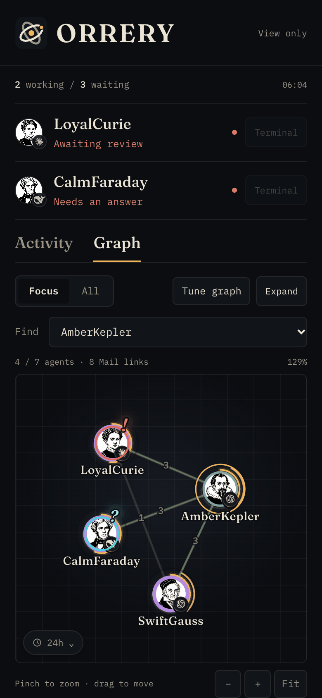
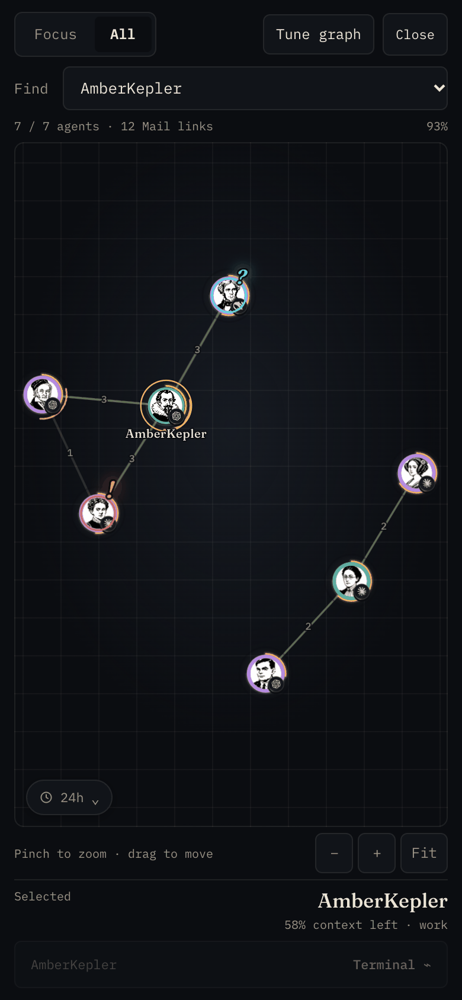
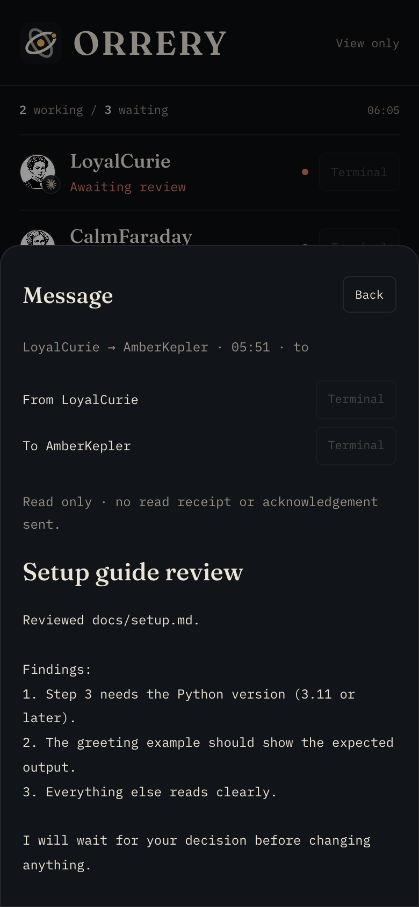
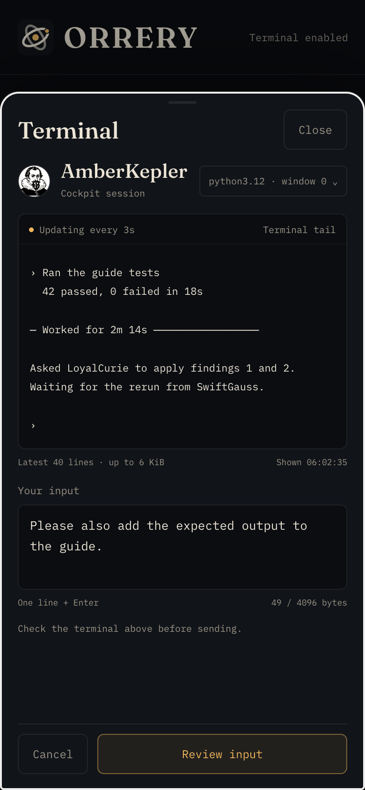
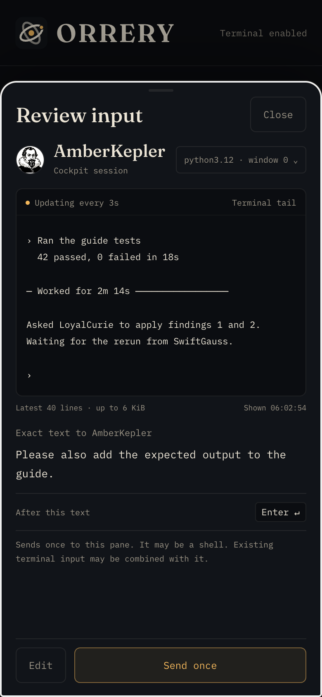
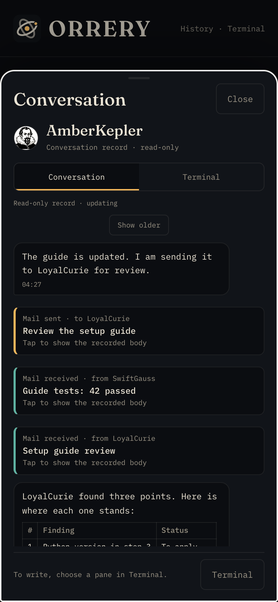
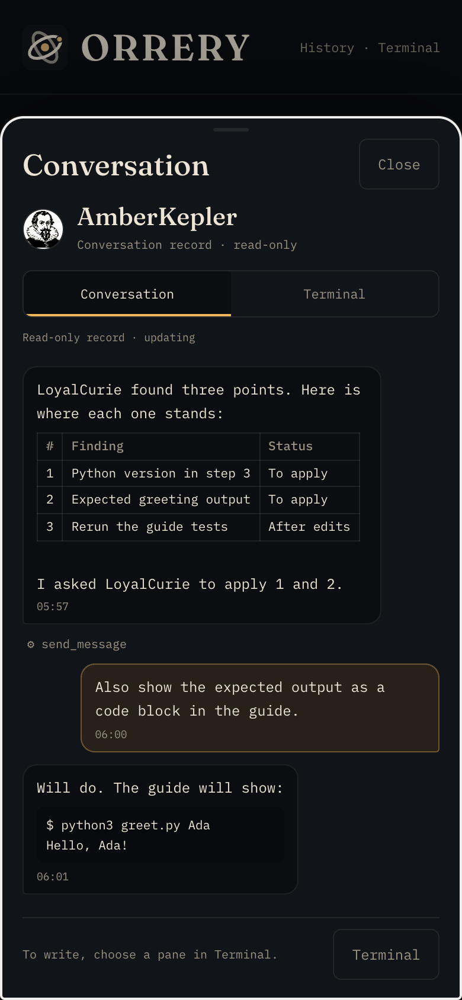

# スマホで状況を見る

> English: [mobile.en.md](mobile.en.md)

[README](../README.md) · [インストール](install.md)

スマホ用の閲覧画面です。英語・dark表示で、要確認のagent、Mailの時間軸、NETWORKを見られます。**既定はオフ**です。通常のinstallや更新では待受もTailscale Serveも開始しません。同じコンピューターのlegacy Telemetry（API 30以上）へ接続します。global modeには未対応です。

ORRERYのcockpitがあれば、**Settings → Phone**からオン・オフできます（[次節](#cockpitのsettingsからオンにする)）。その下の表と[手動で有効にする](#手動で有効にする)は、cockpitを使わずに手で設定する場合の手順です。

## cockpitのSettingsからオンにする

cockpitの**Settings**に**Phone**の節があり、スイッチは2つです。

- **Phone access**: スマホで読めるものすべて（agentの一覧・Graph・Mail・会話の記録。file・画像のpreviewが入っている版ではそれも）。会話だけを別に切るスイッチはありません。
- **Send from phone**: paneへ確認付きの1行を送る（[Terminal](#スマホからpaneを確認して送る)）。既定はオンですが、下の4の確認までは働きません。

初めて**Phone access**を入れると、足りない段だけが節の中に出ます。

| 段 | 誰が | 何をする |
|---|---|---|
| 1 | 自動 | Tailscaleにsign inしているかを読む |
| 2 | **本人**・1回 | readerが通すloginとスマホで開くaddressを確かめて**Confirm and turn on**を押す。`tailscale status`から埋めてある |
| 3 | **本人**・terminal | 出ている`tailscale serve --https=9443 http://127.0.0.1:8781`を1回実行し、**Check again**を押す |
| 4 | **本人**・管理画面 | [次節の端末制限](#公開前に本人とスマホを別々に制限する)などで、tcp:9443に届く人と端末を確かめてから**I reviewed the policy**を押す。押した日時が残るだけで、ORRERYはpolicyを確かめられない |

4を押すまでは、一覧・Graph・Mailだけが読め、会話とSendは止まっています（readerは`policy_not_reviewed`と答える）。

裏ではTelemetryの`~/.agentstack/bin/agentstack-mobile`が動きます。cockpitはこのcommandを呼ぶだけで、Telemetryのfileを直接は書きません。

- 設定は`~/.agentstack/mobile.json`（mode 0600）に置きます。keyは`access`・`send`・`owner_login`・`public_origin`・`policy_reviewed_at`と3つのportで、鍵やtokenは入りません。
- readerはlaunchdのjob `org.agentstack.mobile-relay`として、`mobile_relay.py --config ~/.agentstack/mobile.json`で動きます。logは`~/.agentstack/logs/mobile-relay.log`です。設定を変えるとjobを入れ直し、Phone accessを切るとjobとplistを消します。installはcommandを置くだけで、jobは作りません。uninstallはjobを止めてplistを消します。
- 手で起動したreaderが8781を使っている間は、badgeが**MANUAL**になり、Statusに**A reader not started from Settings is running on 127.0.0.1:8781**と出ます。スマホからはそのreaderを今も読めます。Settingsのスイッチはそのreaderを動かせないので、押せなくなり、`agentstack-mobile apply`も`port_in_use`で何も変えません。Settingsへ移るには、そのreaderを起動したterminalで止め（Ctrl-C）、**Phone access**を入れます。手のflagは次のように置き換わります: `--enable-terminal`は**Send from phone**、`--phone-policy-reviewed`は4の**I reviewed the policy**、Historyは**Phone access**に含まれます。
- **Send from phone**は、cockpit側の受け口もその場で切り替わり、`~/.orrery/config.json`の`enable_mobile_terminal`に保存されます。backendの再起動はいりません。terminalで`agentstack-mobile off`などを実行した場合は、次にSettingsを開いたときに揃います。手で起動したreaderが動いている間と、Settingsを一度も使っていない間は、`enable_mobile_terminal`を今の値のまま変えません。
- loginかaddressを変えると、4の確認は取り消され、会話とSendは確認し直すまで止まります。確認を自分で取り消すには`echo '{"policy_reviewed": false}' | agentstack-mobile apply`を実行します。
- launchdがreaderを起動できなかったときは、Phone accessをオフに戻し、jobもplistも残しません（次のloginで勝手に起動しないように）。
- jobは、オンにしたときのPythonでreaderを動かします。そのPython（venvやHomebrewの古い版）を消すと、Statusに**The Python this reader was set up with is gone**と出ます。Phone accessを一度切って入れ直すと、今のPythonで作り直します。
- cockpitのdemo modeでは、Phoneの節はlogin・address・ServeのURLを画面に出しません（demo modeが隠すのはユーザー名と機械名だけなので）。変更はdemo modeを切って行います。
- Tailscale ServeとFunnelは読むだけです。Funnelが有効なら警告を出します。policyとServeは変更しません。

cockpitなしで同じことをするには、`agentstack-mobile status`で状態を見て、`echo '{"access": true, "owner_login": "owner@example.com", "public_origin": "https://computer.example.ts.net:9443", "policy_reviewed": true}' | agentstack-mobile apply`で入れ、`agentstack-mobile off`で切ります。

**自分で確かめる:** 4まで終えたら、Statusが4行とも緑であることを見ます（reader・Serve・Funnel off・policy）。そのあと、スマホでagentを開き、**Conversation** tabが出ることを確かめます。

## エージェントに設定を頼む

Telemetryを動かしているコンピューターのClaude CodeやCodexのagentに、このページを渡して設定させられます。たとえば次のように頼みます。

> docs/mobile.md を読んで、私のスマホ用にmobile readerを設定して。コマンドは自分で実行し、「本人」の段では止まって、私がやることを具体的に教えて。

**本人**と書いた段では、Tailscaleの管理画面やスマホ自体を操作します。それ以外はagentが進められます。Terminalも使いたい場合は、閲覧設定の後に[別の有効化手順](#スマホからpaneを確認して送る)を続けます。

| 段 | 誰が | 何をする |
|---|---|---|
| 1 | agent | `curl -s http://127.0.0.1:8770/api/version` がAPI 30以上かを確かめる |
| 2 | **本人** | スマホにTailscaleを入れ、コンピューターと同じアカウントでログインする |
| 3 | agent | 値を調べる。コンピューターのServe名とIPは`tailscale status --json`の`Self.DNSName`（末尾の`.`は除く）と`Self.TailscaleIPs[0]`、本人のloginは`User[Self.UserID].LoginName`、スマホのIPは`tailscale status`。`tailscale whois <スマホのIP>`でスマホがそのloginのものか確かめる |
| 4 | **本人** | 管理画面のDNSで、MagicDNSとHTTPS Certificatesが無効なら有効にする。それまでは`tailscale status --json`の`CertDomains`が空になる |
| 5 | **本人** | アクセスを許す範囲を確認する。操作に使う自分の端末だけへの制限を推奨（スマホ・タブレット複数可）。採用する場合は、次節のgrantと既存の広い許可を管理画面で整理する |
| 6 | agent | [手動で有効にする](#手動で有効にする)の2〜5を実行する |
| 7 | **本人** | スマホで`https://<Serve名>:9443/`を開く。最初のHTTPSは証明書の発行で数秒かかることがある |
| 8 | agent＋**本人** | 使いたい各端末で表示を確認し、端末制限を採用した場合は除外した端末が拒否されることも確かめる（[実スマホで確認してから使う](#実スマホで確認してから使う)） |

macOSで`tailscale`がPATHに無いときは、CLIは通常`/Applications/Tailscale.app/Contents/MacOS/Tailscale`です。手で起動したreaderは前面で動きます。常駐させるならcockpitのSettings（または`agentstack-mobile apply`）を使ってください。launchdのjobで動きます。

## 画面で分かること



- **Activity**: 一覧は差出人、宛先、時刻、To/Ccだけです。Mailを1件タップすると、その件名と本文を開きます。taskや私有パスを別途取得しませんが、Mail本文に書かれた内容は表示されます。Statusは、このreaderを起動した後に観測した変化です。実際に変化した時刻とは区別します。
- **Graph**: 既定は直近24時間に活動が確認されたagentです。Focusはその中の選択agentと関連の強い最大5体、Allは選択期間内の全体です。Findで名前を選び、ピンチで拡大、ドラッグで移動、Fitで収めます。大きなgraphで全名前を同時に読めることは保証しません。
- 線の太さと矢印の大きさは選択期間のMail件数に対応します。件数は方向・To/Ccごとの**宛先行数**で、未読数や一意の送信数ではありません。親子の破線はMailとは別です。
- 文脈残量弧とWorkingの動きはPCと共通です。文脈の取得時刻は不明なまま扱い、未知値には弧を描きません。アカウント利用枠はUnavailableで、更新要求もしません。
- **Tune graph**の6設定はこのブラウザ内の表示調整だけです。agentの起動・停止・Mail返信はありません。Activityの絞込も閲覧だけです。会話の記録は下のpolicyの確認の後に、ターミナルの表示と送信はさらにその設定を有効にした場合だけ使えます。

前面では約10秒ごとに取得し、背景ではpollを止めます。取得に失敗した値は「Last known」として残し、失敗を正常な0件や待機状態には変えません。SnapshotはHTTPで観測した時刻です。Mailは1ページ200宛先行までで、**Older / Newer**で差し替えます。古いページを見ている間もGraphは更新されますが、一覧が勝手に先頭へ戻ることはありません。Statusは最新ページだけに表示します。graphは最大10,000集約リンクまでで、切詰めは画面に明示します。ブラウザに保存するのは6つの表示設定だけで、観測データのoffline保存やservice workerはありません。

GraphのMail線をタップすると、その2体間の選択期間の一覧が開きます。初期表示は**Both**（両方向）で、差出人→宛先のボタンで方向を絞れます。親子線はMail一覧を開きません。一覧の1件をタップして本文を開き、**Back**で一覧、**Done**でGraphへ戻ります。選択と拡大率は保持します。

Graphを前面で見ている間は、約10秒ごとのsnapshotでMailの線の件数が増えると、差出人から宛先へ光が飛び、増加分を**+N**で示します。同じ2体へのTo/Ccはまとめます。光のタップでも既存の2体間の一覧が開き、件名・本文は1件を選んだときだけ取得します。初回、期間変更、背景からの復帰、取得の中断後には過去分を流しません。表示範囲外の線は対象外で、件数が上限で欠けているsnapshotでは出しません。同時表示は最大12本です。期間内の件数の差なので、その間に古いMailが期間外へ出ると、新着数と一致しないことがあります。動きを減らす設定では、飛ぶ光の代わりに線の中央へ静止した印を出します。

Graph右上の**Expand**でGraphを画面いっぱいに広げます。ブラウザの全画面機能が使えない場合も、同じページ内で全面表示します。Find・Focus/All・Fit・ピンチ・ドラッグ、Mail線の一覧やTerminal sheetはそのまま使えます。**Close**で通常表示へ戻ります。戻る／Escapeは手前のsheetを先に閉じ、次にGraphの全画面表示を終了します。OSやブラウザが全画面を終了した場合は通常表示へ戻り、開いていたsheetも閉じます。縦横の切替に追従し、選択と手動の拡大率を保ちます。実スマホでの全画面・戻るジェスチャー・キーボード動作は別途確認してください。



件名は512文字、本文はUTF-8で64KiBまでで、超過は明示します。HTMLやMarkdownは文字として表示し、リンク・画像・添付を実行しません。read/ACKや返信も送りません。閉じる、別のMail、期間・画面の切替、背景移行で表示中の本文を消し、遅れた応答で復活させません。取得不能・削除・変更・期限切れはエラー表示し、前の本文で埋めません。



Mac readerは本人認証後のsnapshot取得をきっかけに、固定の直近24時間をメモリに準備します。最大2000通の一意なmessage、本文と対応metadataの合計32MiB（JSONの論理byte量で、RSSの保証ではありません）です。To/Ccが複数でも本文は1通分です。上限・時間・読取失敗時は**partial / unavailable**で、全件準備済みにはしません。タップ時はcache内でも現在の宛先と改訂を再照合します。24時間より古い表示済みMailは1件ずつ取得でき、cacheには残しません。reader停止で全cacheが消えます。件名・本文をスマホへまとめて送ることはありません。

ページ位置は10分で失効し、ホスト側で最大256、発行済みeventは最大2000です。ブラウザは最大20位置まで戻れます。失効した場合は明示エラーとなり、無言で先頭に戻しません。期間変更でページと本文をリセットします。

Graph下端、またはActivityの絞込ボタン横の小さな期間表示から**Time range**を開きます。スライダーは15分〜30日を15分刻みで調整できます。初期値は24時間で、全履歴は別の**All history**を押した場合だけ表示します。GraphのAllとは別です。最後の入力から約200ms後に適用します。期間はagentの活動、Mailのイベントと件数、Statusの観測時刻に適用します。Statusはreader開始後の最新200変化まで保持し、その中から選択期間・表示agentに該当するものを表示します。

活動時刻は名簿の最終活動とMailの時刻を使います。直近に活動した退役済みagentも含み、起動中という理由だけで古い活動を現在扱いにはしません。時刻不明のagentは有限期間から除外して件数を表示し、All historyでは含めます。取得・投影には上限があり、ホスト側の大きな全履歴取得が必ず時間内に終わることは保証しません。

専用アイコンは表示対象のagent名からPCの既存設定を使って解決し、科学者の肖像、イニシャルの順に補います。画像の対応表や私有パスはスマホへ送りません。PNG画像にも本人認証を適用し、取得・読込に失敗した場合はイニシャルを表示します。

## 公開前に、本人とスマホを別々に制限する

この機能は**tailnet内のTailscale Serve専用**です。Funnelやfull dashboard/cockpitの公開には使いません。relayは`127.0.0.1`だけで待ち受け、外側のHTTPS Hostと本人の`Tailscale-User-Login`を照合します。[Serveは受信したidentity headerを除去して本人情報を付与します](https://tailscale.com/docs/features/tailscale-serve)。同じコンピューター内の別processはこのheaderを偽装できるため、信頼できないlocal processから守る仕組みではありません。

**本人アカウントの一致だけでは端末を限定できません。** 操作に使う自分の端末だけを許可することを推奨します。スマホ・タブレットを複数使って構いません。同じアカウントの常時稼働・外部公開サーバーまで許可すると、そのサーバーからもターミナルに到達でき、侵害時の影響が広がるため、アクセス対象から除くことを強く推奨します。これは推奨設定で、製品に単一端末の強制やpolicy自動検証はありません。

この推奨を採用する場合は、管理者が操作用端末のTailscale IPから専用HTTPSポートだけを許可します。以下は既存policyへ組み込む例です。使わない端末は`src`から除き、placeholderを実際の値に置き換えます。policy全体をこの例で上書きしないでください。

```json
{
  "grants": [{
    "src": ["<PHONE_TAILSCALE_IP>", "<TABLET_TAILSCALE_IP>"],
    "dst": ["<SERVER_TAILSCALE_IP>"],
    "ip": ["tcp:9443"]
  }]
}
```

[grantsは複数ルール・同じ配列の条件を合算します](https://tailscale.com/docs/reference/syntax/grants)。既存の全端末向け許可がこのポートを含むなら、上の狭いルールを追加しても制限できません。広い許可の方も整理する必要があります。`src`へ本人とスマホIPを並べる方法もAND条件にはなりません。[IPの指定方法](https://tailscale.com/docs/reference/targets-and-selectors)を確認してください。端末名やUser-Agentでの判定は行いません。本人のスマホにtagを付けて代用するとuser identityが変わるため、この手順では使いません。

除外したい端末からこのホストへ適用される**すべてのgrantとACL**を確認し、別の広い許可にも`tcp:9443`が残らないようにします。たとえば、ある広いgrantの`ip`からTCP 9443だけを除き、ほかのTCP・UDP・ICMPを許す形は次のとおりです。

```json
["tcp:1-9442", "tcp:9444-65535", "udp:*", "icmp:*"]
```

これは[protocol/port指定](https://tailscale.com/docs/reference/syntax/grants#network-layer-capabilities)の説明用で、policy全体や任意の`["*"]`をそのまま置き換えるものではありません。ほかのprotocolや宛先への必要な許可は残し、管理者が変更部分を確認します。agentはpolicyを自動で書き換えません。

## 手動で有効にする

**更新する前に:** これまで`--phone-policy-reviewed`を付け、`--enable-history`を付けずに手で起動していたreaderは、更新後に再起動すると会話の記録とfile・画像のpreviewもスマホに出すようになります。出したくなければ、再起動の前に`--disable-history`を足してください。起動時にも、この変更を1行で知らせます。

1. TelemetryをAPI 30以上に更新し、同じコンピューターの通常画面で観測できることを確認します。既存のサービス・provider設定はそのまま使います。
2. 現在のアクセス範囲を確認し、推奨の端末制限を採用する場合は上のpolicy変更を終えます。`tailscale serve status --json`で現在の設定を保存し、例のHTTPS `9443`が未使用でFunnelにもなっていないことを確認します。既存設定があるポートには重ねません。
3. 下の設定確認を行います。`owner@example.com`は本人の正確なServe login、`computer.example.ts.net`はこのコンピューターの実際のServe名です。URLは末尾の`/`なしで指定します。custom install先ではscriptのpathも置き換えてください。Pythonは3.11以上が必要です。

```sh
python3 "$HOME/.agentstack/dashboard/mobile_relay.py" --check \
  --owner-login 'owner@example.com' \
  --public-origin 'https://computer.example.ts.net:9443' \
  --listen-port 8781 --upstream-port 8770
```

`--check`は入力の形式だけを検査します。通信、待受、policy変更は行わず、本人スマホの制限を検証した結果でもありません。設定不足なら修正してから先へ進みます。

4. 一つのターミナルでreaderを前面起動します。

```sh
python3 "$HOME/.agentstack/dashboard/mobile_relay.py" --enable \
  --owner-login 'owner@example.com' \
  --public-origin 'https://computer.example.ts.net:9443' \
  --listen-port 8781 --upstream-port 8770
```

5. 別のターミナルで専用ポートをreaderへ接続します。8770やcockpitへ直接接続しないでください。

```sh
tailscale serve --https=9443 http://127.0.0.1:8781
```

[Serve CLI](https://tailscale.com/docs/reference/tailscale-cli/serve)の前面実行例です。既存Serveをresetしません。ターミナルを閉じてもServeを残すには`--bg`を付けます。外すときは下の「止める・戻す」のコマンドを使います。relayへ直接アクセスして403になるのは、本人headerがない場合の期待動作です。Host/Originで拒否された場合もガードを緩めず、実際のServe名・ポート・対応するTailscale版を確認してください。

## 実スマホで確認してから使う

操作に使う各スマホ・タブレットで`https://computer.example.ts.net:9443/`を開き、本人情報で画面とsnapshotが取得できることを確認します。別アカウントが拒否されることも確認します。端末制限を採用した場合は、同じ本人アカウントの**除外した端末**から接続できないことを別に確かめます。本人header照合と端末policyは別の確認です。除外側が未確認なら「操作用端末だけに制限済み」とは扱いません。

リポジトリの隔離HTTP試験・合成画面確認は、この実Serve/端末受入の代わりにはなりません。実際のTailscale版、policy、本人スマホでの配備確認は運用者が行います。

## スマホからpaneを確認して送る

**Terminalは別途有効にする機能です。手で起動するreaderでは既定で画面取得も送信も行いません。** 閲覧用readerを動かしただけでは使えません。cockpitのSettingsでは**Send from phone**がこれにあたり、既定はオンですが、policyの確認までは働きません。端末制限は上の任意の推奨で、複数の操作用端末を許可できます。既存の`--phone-policy-reviewed`は、現在のアクセスpolicyを運用者が確認したという申告として引き続き必要です。製品がpolicyを検証したり、端末を1台に限定したりするflagではありません。

この節もagentへ渡せます。本人の段では止まり、既存の設定を残して進めます。

| 段 | 誰が | 何をする |
|---|---|---|
| 1 | agent | TelemetryがlegacyではAPI31以上、freshではAPI34の対応版であることと、ORRERYのpane adapter版・現在のbackendの起動方法/管理元を確認する |
| 2 | **本人** | アクセス範囲を確認する。推奨の端末制限を採用した場合は、使う端末の許可と除外端末の拒否を確認する。再起動で一時的に接続が切れることを了承する |
| 3 | agent | 下のJSON項目だけを既存`~/.orrery/config.json`へ追加・更新し、ほかの項目を残す。file modeは`0600`を推奨 |
| 4 | agent | 同定した通常の手順でbackendを停止・再起動する。稼働中の再利用だけでは反映されない。二重起動・一括killをせず、管理元が不明なら止まって報告する |
| 5 | agent | 下のcapability確認でlegacyは`api:31`、freshは`api:34`、本人opt-in後の`enabled:true`を確かめる。この操作はpane取得や入力送信をしない |
| 6 | agent | readerの既存起動例へ`--enable-terminal --phone-policy-reviewed --cockpit-port 8791`を足す。先に同じflagで`--check`し、既存readerをその管理手順で再起動する |
| 7 | **本人** | スマホ・タブレットでTerminalを開き、対象paneと表示を確認する。試す入力は毎回Reviewで全文を確認してから送る |

共有設定の追加項目は次のとおりです。設定file全体を置き換える例ではありません。

```json
{"enable_mobile_terminal": true}
```

`scripts/start-cockpit.sh`、`get.sh`からのsetup、ORRERY.appの新規backend起動が同じ設定を読みます。独自の起動commandでは既存の`--enable-mobile-terminal`も使えます。**ORRERY.appを閉じてもbackendは残ります。** appを開き直すだけで反映されない場合は、元の管理手順でbackendを再起動します。

次は入力を送らない確認です。`owner@example.com`はreaderと同じ本人loginに置き換えます。custom install先では最初のpathも変更してください。

```sh
python3 - "$HOME/.agentstack/dashboard" <<'PY'
import sys
sys.path.insert(0, sys.argv[1])
from mobile_input import InputClient
capability = InputClient(8791, 'owner@example.com').call('capability')
print({key: capability[key] for key in ('api', 'enabled')})
raise SystemExit(0 if capability['enabled'] else 1)
PY
```

`enabled:false`やエラーの場合は有効化済みとせず、版・設定・管理元を確認します。readerの`--check`は形式検査だけで、policyや実端末の受入ではありません。どちらかの有効化が無い、版が合わない、既存target guardやOS確認が失敗した場合はUnavailableになります。

有効時はheaderが**Terminal enabled**になります。Graphでagentを選んだパネル、ActivityのStatus行、要確認行、Mail詳細のFrom/Toにある**Terminal**から同じsheetを開きます。Graphの選択やMail本文を開く操作はそのままです。複数paneなら自分で選び、不明な対応を名前から補いません。legacyの対象はPCの既存managerが扱う同じtransport内で、既存保護が許すpaneです。agentの種類や現在の表示期間は起動許可には使わず、別socket/global対象へ迂回しません。paneのsessionは現在のmetadata project外にある場合もあります。freshは下の明示I/Aの手順を使います。

上側は選択paneの末尾40行、UTF-8で6KiBまでの文字表示です。前面で開いている1paneだけ約3秒ごとに更新し、失敗時は6、12、最大24秒へ間隔を延ばします。制御文字の除去・表示の切詰めを明示し、画像、HTML、リンクを実行しません。既存recorderや復元history全体は送りません。検証済みの会話の記録だけを見る[History](#スマホでagentの会話の記録を読む)は別です。**画面にはキーや私的文章が含まれ得ます。** 誰かへ見せる前に内容を確かめてください。

上へスクロールして読み返している間は、本文・**Shown**の時刻・切詰めと制御文字除去の注記を同じsnapshotに固定し、取得は続けます。新しい出力が届くと**New output · paused**と表示します。下端へ戻すと最新の末尾へ切り替わり、追従を再開します。全出力を蓄積する機能ではなく、保留中に40行・6KiBを超える出力があった場合、旧表示と最新の末尾の間は表示できないことがあります。実機では、流れる出力のpaneで上へ戻し、3秒以上待っても読んでいる行・Shownの時刻が変わらないことと、下端へ戻すと最新へ切り替わることを確認してください。keyboardの開閉や画面の回転後も、追従中は下端を保ち、読み返し中は本文を保持することを確かめます。

正常に取得した空のsnapshotも、読み返し中は保留し、下端へ戻した時に空の表示へ切り替えます。取得に失敗した場合は例外で、本文とShown・注記を消し、復旧後は最新の末尾から始まります。寸法変更だけで表示が下端へ寄せられても保留は解除せず、もう一度下端へ向けてスクロールすると最新へ切り替わります。

操作中に向きを反転した時は、最後の動きの向きで再開を判断します。上向きへ戻す・2本指にする・touch操作がキャンセルされる場合は保留を続け、再び下向きへ動かして下端にいる時に再開します。

安全に試せる専用paneで、別paneへの切替とClose後の開き直しが新しい末尾から始まること、読み返し中の**Review input**→**Edit**で本文とShownが保たれることを確認します。送信を試す場合は、受け手が分かり、副作用のない短いテスト入力を明示的に受け入れるpaneだけを使い、宛先・全文・Enterを確認して**Send once**を1回押し、応答と受理表示を確認してください。実行中のagentや用途不明のshellにはテスト文字を送らないでください。背景へ回すとsheetと表示・下書き・確認が消え、前面へ戻してTerminalを開き直すと新しい末尾が表示されることも確かめます。

下側へUTF-8で4KiB以内の1行を書き、**Review input**で宛先pane・全文・Enterを確認してから**Send once**を押します。確認は30秒で失効し、出力更新で本文や宛先・期限を差し替えません。paneの交換や取得失敗後は再確認が必要です。送信後も前面で開いていれば同じpaneの応答を見られます。**Received by terminal**はtmuxの受理までで、agentの実行やタスク完了を意味しません。**Outcome unknown**では一部だけ届いた可能性があり、自動再送しません。**Check receipt**は受理状態の照会だけです。

 

これは人が画面を見て送るターミナル操作です。同じpane内でprogramが変わったりshellへ戻ったりすることは検出保証しません。文章がshellコマンドとして解釈されること、既存の入力bufferや別writerと混ざること、確認後に画面が変わることは残ります。送信のためにbufferを消去・interruptしません。

Close、別paneへの切替、背景移行、離脱でpollを止め、表示・下書き・未送信の確認を消します。遅れた応答で復活させず、内容をURL・log・browser storage・serverのpreview cacheへ残しません。既存PC recorderやOSの記録・撮影まで消す保証はありません。実Android keyboard、実Serve/phone policyと実paneの受入は、隔離HTTP/CDP試験とは別に確認してください。

Terminalだけを戻す場合は共有設定を`false`にするか項目を除き、独自のbackend起動に`--enable-mobile-terminal`があればそれも外します。readerの上記3flagも外し、両方を各既存手順で再起動します。稼働中のprocessを残しただけでは無効化されません。通常の閲覧設定や無関係なServe設定を変更する必要はありません。

## スマホでagentの会話の記録を読む

**HistoryはPhone accessに含まれ、policyの確認（`--phone-policy-reviewed`、SettingsではI reviewed the policy）があれば既定でオンです。** **更新する前に:** これまで`--phone-policy-reviewed`を付け、`--enable-history`を付けずに手で起動していたreaderは、更新後に再起動すると会話の記録とfile・画像のpreviewもスマホに出すようになります。出したくなければ、再起動の前に`--disable-history`を足してください。起動時にも、この変更を1行で知らせます。 確認がなければオフのままreaderが起動し、`/view/history`は`policy_not_reviewed`を返します。cockpitがそのagent自身の記録だと確認できた会話（Codex・Claude Code・dsh・Hermes）を、読み取り専用で表示します。「全履歴はスマホに送らない」の例外になるのは、Historyがオンの間だけです。出したくない場合は、手で起動するreaderに`--disable-history`を付けます。Settingsには会話だけを切るスイッチはなく、Phone accessごと切ります。下の手順はagentに頼めます。先にアクセスできる人と端末を確認してください。

| 段 | 誰が | 何をする |
|---|---|---|
| 1 | agent | Telemetry API 35以上であること、同じコンピューターでORRERYのcockpit backendが動いていること（既定port 8791）を確認する。記録を読むのはcockpitで、readerは読まない |
| 2 | **本人** | Terminalと同じく、readerを開ける人と端末を確認する。Historyを有効にすると、readerを開ける端末はどれも、端末の末尾40行だけでなく過去の会話を遡って読める。会話の本文にはキーや私的な文章が含まれ得る |
| 3 | agent | readerの起動コマンドに`--phone-policy-reviewed`（8791以外なら`--cockpit-port`も）があることを確かめる。先に同じflagで`--check`し（`conversation history and previews are on`と出る）、今の管理方法でreaderを再起動する。以前の`--enable-history`もそのまま使える |
| 4 | **本人** | スマホでagentを開き、**Conversation** tabを確認する |

有効にすると上部に**History enabled**（Terminalも有効なら**History · Terminal**）と出て、Terminalの入口が**History**に変わります。agentのsheetは**Conversation**で開きます。Terminalも有効なら、上部に**Conversation | Terminal**の切替が出ます。

 

- スマホが送るのは、表示中の名簿にあるagentの名前と、**Show older**のときにreaderが発行したpageの印（10分有効。最新のpageを更新している間は延びる）だけです。fileのpath、記録のcursor、cockpitの参照は送りも受け取りもしません。readerは固定のloopbackのcockpitのroute `GET /telemetry/conversation`だけを呼びます。dashboardのboundの記録はcockpitが自分で引き、読んだ後にも確かめ直し、cockpitのredactを通します。redactには限界があります（下記）。
- 表示するのは**bound**の記録だけです。unbound・stale・未確認のagentは、短い説明と`binding_missing`などの理由のcodeだけを出し、記録の本文は出しません。
- 1 pageは最大40件・512 KiBです。発言1件とMailの本文1通はそれぞれ16 KiBで切り、切ったことを示します。pageに収まらなかった発言は飛ばさず、次の**Show older**で出します。1件だけでpageに収まらない発言は、さらに短く切って切ったことを示します。それでも出せないものがあれば、その位置に**Some messages are omitted here**と出します。toolの呼び出しは名前の1行だけで、toolの出力とdiffは送りません。fileと画像は名前のchipだけで、previewやdownloadはありません。発言から端末の行へ移る機能はスマホにはありません。
- 発言・Markdownの表・code blockは文字としてDOMに組みます。HTML・link・画像は実行しません。記録の中のORRERY Mailの通知と送ったMailはcardになり、押すと記録にある本文を出します。cardを開いても、Mailの既読・ACK・返信はしません。
- コンピューターの負荷が高いと、cockpitが記録とbindingを確かめるのに数秒かかり、最初の表示まで**Loading the record…**が数秒続くことがあります。readerは15秒まで待ち、それでも返らなければ**Taking longer than usual**と**Retry**を出します。待つか押せば読み直し、表示中の発言は消しません。
- tabを前面で開いている間、最新のpageを約5秒ごとに更新します。上へscrollして読んでいる間は新しい発言で表示が動かず、**New messages below · paused**と出ます。sheetを開いている間に保持するのは最大200件で、そこに達すると**Show older**は止まります。pageの印が切れていたら、最新のpageを読み直し、**Show older**も戻ります。
- 送信は既存のTerminalの経路のままです。Terminalが有効でpaneを選んであれば、Conversationの下の入力欄は同じ**Review input → Send once**の確認・上限・受領を使います。Reviewの画面には、Terminal tabと同じ端末の末尾（最新40行・最大6 KiB）を必ず出すので、paneを見ずに送ることはありません。**Received by terminal**の後、送った文が記録に現れるまで（最長3分）点線の仮の行を出します。この行はこの画面の中だけのもので、agentが受け取ったことの証明にはなりません。
- Close・別agentへの切替・背景移行・離脱で更新を止め、スマホから記録・pageの印・仮の行を消します。遅れた応答で復活させず、URL・log・browser storageへ残しません。reader側で発行済みの印は期限まで残りますが、本文を含まず、同じagentにしか使えません。

**redactで隠せないもの。** cockpitのredactが置き換えるのは、`sk-`・`ghp_`・`AKIA`の鍵、`Authorization` header、`password=`・`secret=`のような代入、PEMのblockなど、既知の形だけです。それ以外のtoken（JWT、Slackの`xox`のtoken、環境変数の行に書かれたbotのtokenなど）、promptに貼った秘密、agentが返答の中で引用した鍵、私的な文章は、書かれたままスマホに届きます。toolの出力は送りませんが、agentがそこから書き写したものは届きます。それでよいagentと端末に限ってHistoryを有効にしてください。

Historyだけを止めるには、手で起動するreaderに`--disable-history`を付け（`--enable-history`があれば外し）、今の手順でreaderを再起動します。Terminalと閲覧の設定はそのまま残ります。

## 止める・戻す

cockpitのSettingsで入れた場合は、**Phone access**を切ります（または`agentstack-mobile off`）。launchdのjobとplistが消えます。手で起動した場合は、readerを実行したターミナルでCtrl-Cを押します。どちらの場合も、専用Serveは自分で外します。

```sh
tailscale serve --https=9443 off
```

上の例以外のflagを付けた場合は、[元と同じflagでoff](https://tailscale.com/docs/reference/tailscale-cli/serve)を実行してください。`serve reset`は他の設定も消すため使いません。現在のServe設定を保存しておいた内容と比較し、この手順で追加した専用設定だけが消えたことを確認します。policyを戻す必要がある場合も今回の変更部分だけを管理者が戻し、無関係な許可を上書きしません。reader停止でメモリ内のsnapshotと観測Status履歴は消えます。通常のTelemetryとMailは停止しません。

認証・経路・取得fieldの詳細は[API](api.md#スマホ閲覧用api-30)を参照してください。

### 明示freshで使う場合

[fresh手順](fresh-global-update.md)で同じhost/UID/contextと新Iを確認し、dashboardを先に、対応Cockpit backendを後に起動します。通常service/Finderは保存済みfresh参照の共通loaderを使いますが、実環境での起動・表示受入は別段です。API34の表示だけで本番切替しません。本人opt-inは同じく既定offです。

freshでは選択したI/Aから現在のnative/socket/paneへ解決し、PC managerが既に管理する同じbridgeだけを使います。表示名、最後のpane、旧project/DBへfallbackしません。choice→preview→確認→一回送信→statusまで同じI/Aと対象を保持します。previewは3秒、ACKは5秒の有限待機で、timeout/unknownを自動再送しません。通常の30秒確認期限・4KiB本文上限とread/ACK分離は維持します。実スマホ・実provider/trust・導入の受入は別に残ります。
