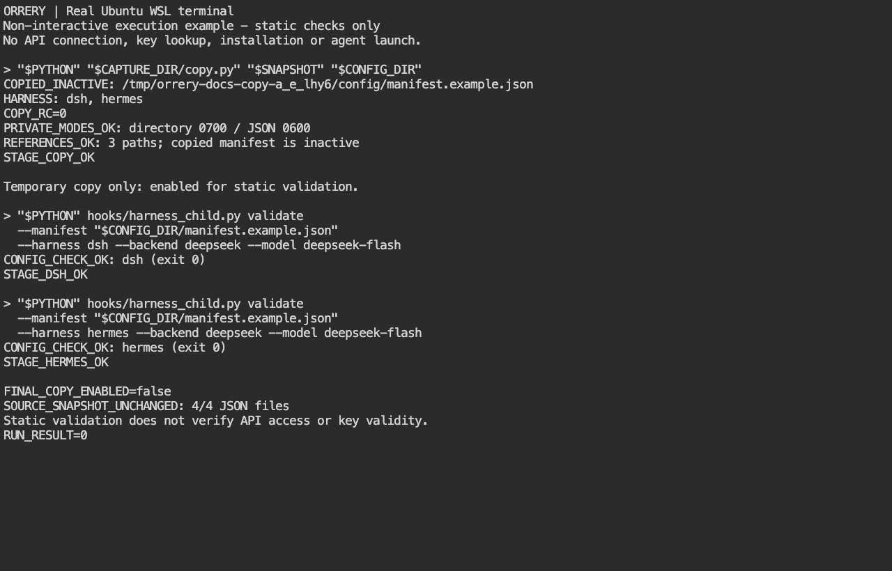

# dsh / Hermes の非有効な設定例

> English: [README.en.md](README.en.md)

**最初にDeepSeek・Localを追加する方へ：** [初期設定ガイド](https://github.com/gyroid-eth/orrery-telemetry/blob/master/docs/native-setup.md)で、APIキーの取得・OSへの保存・runtime追加の順序を確認してください。この文書は、設定例をコピーしてつなぐ工程の詳細です。

例の版: 1。これは設定補助用の例です。installは接続先の有効設定や鍵を作りません。
ここにあるmanifestをそのままサービスへ登録しないでください。

## B標準：runtime参照入りの例を使う

harnessを任意導入したinstallは、検証済みのcurrent/所有receiptからruntime参照を
埋めた `resolved/<snapshot-id>/` の4JSONを作り、完了時にその場所を表示します。
manifestは常に `enabled: false` です。両harness未導入なら静的例だけを配り、
片側だけならsnapshotのmanifestもそのharnessだけを参照します。
未導入側のJSONにはplaceholderが残るため、そのまま有効化しないでください。

1. 利用者がharness・backend・正式model ID・新しい私有設定の保存先を選びます。
2. 既存agentへ「このREADMEに従い非秘密設定だけ準備して」と依頼できます。
   agentは表示されたsnapshotを**別の新規dir**へコピーし、dir0700/JSON0600にします。
   既存設定を上書きせず、必要なら変更案を先に確認します。
3. コピー先のmanifestの `harnesses.dsh.config_file` と
   `harnesses.hermes.config_file`、dsh-configの `backend_file` をコピー先の
   **絶対path**へ直します。使うharnessだけなら不要なentryを省きます。
   JSON内の環境変数やplaceholderは自動展開されません。
4. backend URL・model・非秘密の資格参照を本人の選択へ合わせます。
   鍵値をagentへ貼ったり、JSON/env/argvへ記録したりしません。
5. 本人が下記のOS秘密保管へ登録し、agentへは「登録済み/失敗」と非秘密refだけを返します。
6. 本人が利用者コピーの有効化を承認した後、そのコピーだけを `enabled: true` にします。
   既存の `hooks/harness_child.py validate --manifest <コピー先manifestの絶対path>
   --harness <dsh|hermes> --backend deepseek --model <正式ID>` を確認済みPythonで使えます。
   これは静的参照検査で、資格取得・接続・Mail成功の試験ではありません。
7. 本人承認の下で既存installerの `--managed-spawn-config <絶対path>` へ参照を渡します。
   install/service操作を伴うためagentが無断で実行しません。設定後に標準のNew Agentから
   起動し、親子Mail・通常終了・同identityのresumeを別に受け入れます。

両harnessでは4file/13参照（runtime由来10＋例内peer参照3）。本人の手書き回数ではなく、
installとagentが合わせる項目です。Bはruntime参照の手転記を省きますが、保存先・接続先・
秘密入力・有効化承認・実受入を自動で済ませるものではありません。


### agentを使わずにDeepSeekの設定例を準備する

Claude CodeやCodexを使わない人も、installerが作ったBのsnapshotから設定できます。
先に[初期設定ガイドの手順2～4](../../docs/native-setup.md#2-dshhermesを追加する)で、
harnessの導入とキーのOS保存を済ませます。以下のコピー処理はキーを取得しません。

Telemetryのソースフォルダー内で実行します。次の `SNAPSHOT` はinstallerの
`inactive snapshot (copy and finish setup):` に続く絶対パス、
`PYTHON` は同じinstallerの `python:` に続くPython実行ファイルの絶対パスへ置き換えます。
`CONFIG_DIR` は新しい設定の保存先です。すでに存在する場合はコピーせず停止します。
新しい保存先を選び、既存設定を消したり上書きしたりしないでください。

```bash
# Replace these two paths with the values printed by your installer.
SNAPSHOT='/absolute/path/to/examples/native-harnesses/resolved/snapshot-id'
PYTHON='/absolute/path/printed-after-python'
CONFIG_DIR="$HOME/.config/orrery/native-deepseek"

"$PYTHON" - "$SNAPSHOT" "$CONFIG_DIR" <<'PY'
import json
import os
from pathlib import Path
import sys

source = Path(sys.argv[1]).expanduser().resolve(strict=True)
target = Path(sys.argv[2]).expanduser().resolve()
names = (
    "manifest.example.json", "dsh-config.example.json",
    "dsh-backends.example.json", "hermes-config.example.json",
)
documents = {name: json.loads((source / name).read_text()) for name in names}
manifest = documents["manifest.example.json"]
if manifest.get("enabled") is not False or not manifest.get("harnesses"):
    raise SystemExit("STOP: choose an inactive installer-generated runtime snapshot")
for harness, entry in manifest["harnesses"].items():
    if harness not in ("dsh", "hermes"):
        raise SystemExit("STOP: unknown harness")
    entry["config_file"] = str(target / (harness + "-config.example.json"))
documents["dsh-config.example.json"]["backend_file"] = str(
    target / "dsh-backends.example.json"
)
os.umask(0o077)
target.mkdir(mode=0o700, parents=True, exist_ok=False)
for name, document in documents.items():
    with (target / name).open("x") as stream:
        json.dump(document, stream, indent=2)
        stream.write("\n")
print("COPIED_INACTIVE:", target / "manifest.example.json")
print("HARNESS:", ", ".join(manifest["harnesses"]))
PY
```

`COPIED_INACTIVE:` と `HARNESS:` が表示されればコピー完了です。
有効化はまだ行っていません。`FileExistsError` は保存先が既存という意味です。
snapshotが出ず静的例しかない場合は、このコピーへ進まずharnessの導入結果を確認します。
片方だけ導入した場合、`HARNESS:` に出たharnessだけを使います。未導入側のJSONは使いません。

コピー先の `manifest.example.json` をテキストエディターで開きます。
DeepSeekの標準modelと保存先（`orrery-dsh-deepseek` / `api-key`）を使うなら、
URLやキーの参照先は変更不要です。OS保存が済んだことと使うharnessを確認してから、
先頭の `"enabled": false` だけを `"enabled": true` に変更して保存します。
キーそのものをJSONへ入力しません。別の保存先やLocalモデルを使う場合は、先に下の変更表を適用します。

同じターミナルで、使うharnessの検査を実行します。
Hermesを使う人は `--harness dsh` を `--harness hermes` に変更します。
両方を使う人は、それぞれ1回ずつ検査します。

```bash
"$PYTHON" hooks/harness_child.py validate \
  --manifest "$CONFIG_DIR/manifest.example.json" \
  --harness dsh --backend deepseek --model deepseek-flash \
  && printf 'CONFIG_CHECK_OK\n'
```

`CONFIG_CHECK_OK` が出れば設定の検査は成功です。API接続やキーの正しさの確認ではありません。
`harness_not_enabled` は有効化忘れ、`model_mismatch` はmodelがmanifestの一覧にないことを示します。
`KeyError` なら、指定したharnessが先ほどの `HARNESS:` に含まれるか確認します。
`runtime_not_prepared` なら、harnessの導入結果とsnapshotの世代を確認します。
ほかのエラーはキーを含めず文面を確認し、検査が通るまでinstallへ進みません。



[コピーから設定検査までのGIF（10秒）](../../docs/img/wsl-copy-static-validation.gif)。
実WSLのターミナルをMacのChromeから表示した非対話の実行例です。3つの実画面を読みやすい長さで表示しており、手入力や実時間の録画ではありません。
画面の `copy.py` は上記のコピー処理をファイルにした収録用スクリプトです。`STAGE_*` などは収録用の追加検査で、利用者のコマンドには表示されません。実行するのは上のコードブロックで、成功の目印は `COPIED_INACTIVE`・`HARNESS`・`CONFIG_CHECK_OK` です。画面の `/tmp/...` も収録用の保存先です。
**自分の設定では、検査に通ったコピーを `enabled: true` のまま使ってください。** 画面末尾の `FINAL_COPY_ENABLED=false` は収録用コピーの後片付けです。API接続・キーの取得・installは行っていません。

検査に成功したら、利用者が同じフォルダーで次を1回実行します。変更案が出た場合は
内容を確認して本人がyes/noを選びます。`Install complete` の後にブラウザを再読み込みし、
[最初の1体を試す](../../docs/native-setup.md#6-new-agentから1体だけ試す)へ進みます。

```bash
./scripts/install.sh --keep-mail --managed-spawn-config "$CONFIG_DIR/manifest.example.json"
```


## A受け皿：未導入・model変更・調整

同dirの [manifest](manifest.example.json)、[dsh config](dsh-config.example.json)、
[dsh backends](dsh-backends.example.json)、[Hermes config](hermes-config.example.json)
は未完成の静的例です。`<ABS_...>` を残して起動できません。既存agentは確認済みの
current/receiptとHermesのcommitted PM factsを使い、非秘密参照を合わせられます。
世代名/venv名を推測したり、実profile/認証store/記憶や広いruntimeを探索したりしません。
導入が不足・不整合なら止めて導入の修復を依頼します。

静的4JSONはMacの資格形式です。WSLでAを使うときは次節の置換を必ず行います。
model変更時も主/helperは同じbackendの正式IDだけを許可し、effortや要求数/寿命の
試し用固定値を足しません。例には巨大なcontext/output上限を設定していません。

### Local / Strataへ変更する場合

<a id="dynamic-local-connections"></a>

#### 動的接続（推奨）

既存のworkstation／remoteを含め、対象Localをそれぞれ一度だけ移行します。接続IDと本人が付けた表示名を区別し、私有manifestのその接続の `model` / `models` を次に置き換えます。

```json
"local-workstation": {
  "kind": "strata",
  "label": "Workstation",
  "model_source": "server",
  "urls": ["https://llm.example.com/v1", "https://second.example.com/v1", "https://third.example.com/v1"],
  "context_override": 64000
}
```

`urls` は異なるAPI baseを1本以上設定でき、URL数やGPU数を2に固定しません。末尾が `/v1` ならそのまま、それ以外は `/v1` を追加します。URLへ資格・query・fragmentを入れません。同じ接続の資格を使うURLだけをまとめ、資格が違えば別接続IDにします。HTTP並列数は2、各requestのtimeoutは3秒です。設定URLが増えれば一覧取得時間も増えます。

dsh backend mapとHermes profile mapには同じ接続IDを保持します。動的modeのdshは既存 `keychain` selector、またはmanifestのLinux `credential_ref` を使います。旧 `model` / `model_definition` / `base_url` は正本でなくなり、削除できます。Hermesは組込みと衝突しない `provider` 名と既存資格参照を保持し、profileの旧 `model` / `context_length` / `base_url` / `api_mode` を削除します。manifest URLからHermesの `chat_completions` routeを作るため、別のmodel一覧・URL更新は不要です。runtime証跡・path・鍵の保護は維持します。Macの一覧取得は正規の `/usr/bin/security find-generic-password -s SERVICE -a ACCOUNT -w` 参照に対応し、任意の `key_cmd` helperは実行しません。

任意の `context_override` は、選択した同じmodel行の `meta.n_ctx` が有効でない場合のfallbackです。有効な報告値があればそれを優先し、どちらもなければ共通既定64,000 tokenを使います。画面の `server` / `override` / `default` は由来を示し、後2者は実測値ではありません。dshの生成出力上限は既定8,192 token（context以内）、effort未報告は省略、helperはSame as mainです。有効な `data[].id` はstatus欠損・未知でも選択可、明示 `status.value: unloaded` だけを無効にします。nativeへ送るのはlabelでなくIDです。同名IDでも接続・URL番号が違えば区別します。

静的検査は確認済みPythonで `hooks/harness_child.py validate --manifest <私有manifest> --harness <dsh|hermes> --backend <接続ID> --url-index <0始まり番号> --model <ID>`。通信・鍵取得はありません。通常の承認済み `--keep-mail --managed-spawn-config <manifest絶対path>` installを一度行い、両NEW AGENTをreloadします。一覧は既存資格参照で取得し、実起動・exact resumeのcommand直前には選択URLの `/v1/models` だけを1回照合します。ID消失・明示unloaded・取得失敗は別modelへ移らず拒否します。catalogの `url_key` をPOST／launcherへ保持し、設定URLの変更・並べ替え時は再選択が必要です。exact resumeは元の接続・URL・modelを保持し、接続を移行した旧固定sessionは手動判断が必要です。通常手順で旧copyへ戻せるよう保存します。

公式一次資料にあるmodel一覧の例です。URLの例であり、全harnessへの互換保証ではありません。

- [llama.cpp](https://github.com/ggml-org/llama.cpp/blob/master/tools/server/README.md)：`--port 8080` を明示した場合、API baseは `http://localhost:8080/v1`。
- [LM Studio](https://lmstudio.ai/docs/developer/openai-compat/models)：`http://localhost:1234/v1`。JITではdownload済みmodelも一覧に含み得るため、status欠損をロード済みとしません。
- [vLLM](https://docs.vllm.ai/en/latest/getting_started/quickstart/)：`http://localhost:8000/v1`。運用に合わせserver側の認証を設定します。
- [Ollama](https://docs.ollama.com/api/openai-compatibility)：`http://localhost:11434/v1`。local APIはclientのkeyを無視しますが、ORRERYの既存資格参照要件は維持します。

一覧取得はHTTP/HTTPSに対応します。dshは既存のDeepSeek Messages adapterのままで対応Messages endpointが必要です。一覧取得成功だけではprotocol互換を証明しません。HermesはHTTPS必須のまま、動的modeではOpenAI chat completionsを使います。HTTPのみの例をHermesへ直接は渡せません。新adapter・TLS例外・model操作は追加せず、最後の観測後の変更や指定IDを無視するserverも保証外です。

#### 従来の固定model接続（互換）

既存Localを残して別のLocalも追加する場合は、置換せず[複数接続の設定](../../docs/configuration.md#native-connections)に従い、manifest・dsh backend・Hermes profileへ同じ新接続IDを追加します。

Bの標準例はDeepSeek用です。Localはbackend IDを `strata` とし、利用者コピーの
次のfieldを同じ接続先へ揃えます。runtime参照とコピー先の絶対pathはそのまま整合させます。

| file | 変更するfield |
| --- | --- |
| manifest | `backends.strata.model` / `models` に利用者が確認した正式model IDを設定 |
| dsh-backends | `backends.strata` に変更し、`model` と `base_url` を正式ID・対応APIのHTTP/HTTPS URLへ設定 |
| Hermes config | `profiles.strata` に変更し、`model` / `base_url` / `api_mode` を設定。URLはHTTPS必須。modeは接続先が提供する `chat_completions` または `anthropic_messages`。`provider` は組込み名と衝突しない任意名（例 `orrery-strata-manual`） |
| OS資格ref | Macはdshの `backends.strata.keychain` とHermesの `profiles.strata.key_cmd` を本人指定の同じ資格へ。WSLはmanifestの `backends.strata.credential_ref` を1正本とし、対応するkeychain/key_cmdを削除 |

DeepSeekのURL・model・資格selectorを残したままLocalとして使いません。endpointのpathや
API modeは推測せず、利用者が確認したserver仕様に合わせます。dshのこの設定には
`api_mode` の切替fieldはないため、Hermes用fieldを足して同じprotocolになるとは扱いません。
不要なDeepSeek entryはコピーから省き、下記の `--model` も `backends.strata.models` に含めます。

確認済みPythonで `hooks/harness_child.py validate --manifest <コピー先manifestの絶対path>
--harness <dsh|hermes> --backend strata --model <正式ID>` を実行します。
これは静的検査で、Mac/WSLのDeepSeek/Local×dsh/Hermesの4通りの標準UI起動・接続の
実機受入とは別です。秘密入力と有効化の本人承認は上の手順と同じです。

## MacとWSLの資格参照

**Mac:** dshはdsh-backendsのkeychain.service/account、Hermesはprofileのkey_cmdで
同じ会話用selector `orrery-dsh-deepseek` / `api-key` を参照します。本人がKeychain Access等の
OSの非表示入力で登録します。agentはsecurityのlookupを実行せず、鍵の表示を求めません。
このselectorは既存Mac残高workerの `deepseek-api` と別です。会話成功は残高の取得成功や
同一accountの証明ではなく、残高は別の未受入項目です。二重鍵登録を求める手順ではありません。

**WSL / LinuxのSecret Service経路:** #330対応sourceを含む製品のLinux snapshotでは、
manifest.backends.deepseekへ次の1正本だけを置き、dshのkeychainとHermesのkey_cmdを省きます。
静的Aを手で補助する場合も、この2つの旧fieldを削除してから同じ形へ置換します。

```json
{
  "credential_ref": {
    "store": "secret-service",
    "attributes": {"service": "orrery-dsh-deepseek", "account": "api-key"}
  }
}
```

本人が同じattributesのSecret Service項目へ秘密を保存します。必要なSecret Service、
D-Bus session、unlock、`/usr/bin/secret-tool` の準備はOS側の工程です。agentにlookupや
内部readerの直接実行をさせず、秘密登録を自動化しません。両harness/guard/quotaは同refを
製品内部のreaderへ投影し、旧Mac資格との併記はエラーです。MacへSS refを足したり、
失敗時に別storeへfallbackしたりしません。

非有効例の生成はSecret Serviceの存在/解除/取得成功を検査しません。Ubuntu WSLの実Node/PM、
秘密入力、標準起動/Mail/終了/exact resumeは実機受入前です。旧sourceへのコピーだけでは
WSL機能は増えません。macOS legacyとLinux legacyの静的準備を、全OS/modeの保証と混同しません。

## 更新・削除・証拠の範囲

既存例/snapshotは更新でも上書きせず、不足分と別内容の新snapshotだけを追加します。
既存保持の表示は最新/使用可の検証を意味しません。古い例を使い続けるか、利用者が退避して
新版を新規配置するかを選びます。installは未記録の既存例を所有化しません。
uninstall/purgeは記録hashと一致する未編集の例だけを削除し、編集済み・リンク・未記録file・
利用者コピーを保持します。snapshotの有効化や利用者設定の自動移行はありません。

公開DeepSeek endpoint候補はdshが `/anthropic`、Hermes Chatが `/v1`。
固定source上の投影と、標準例の全bytesによる実wire受入は別です。dshの最終wire、本人の秘密入力、
新規利用者のMac/WSL標準例の通し受入は未確認で、配布/所有のsynthetic試験だけで合格としません。
